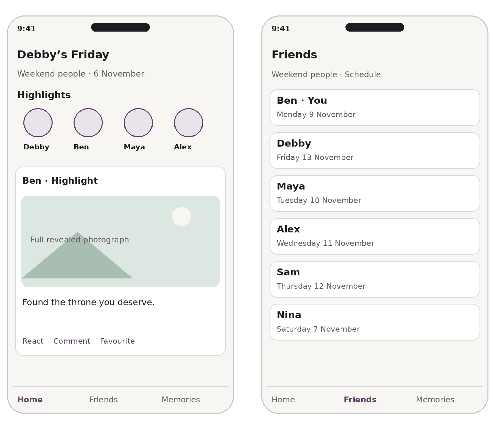
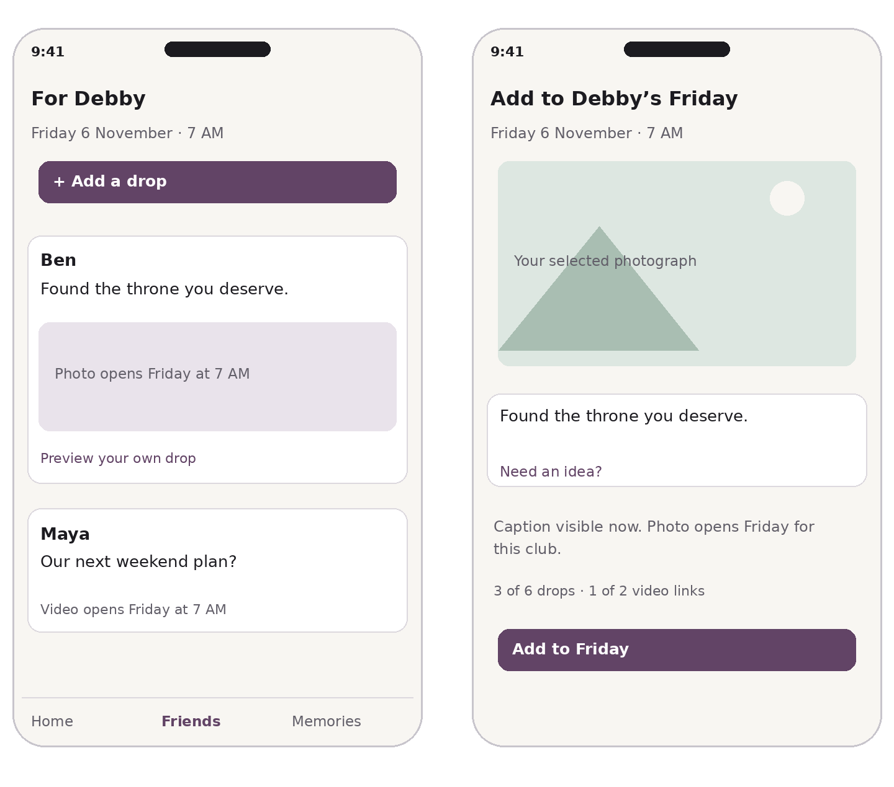

# Tadayo Build and Design Specification

Version 3 · 31 October 2026

> Converted to Markdown from the founder's `Tadayo_v3_Build_and_Design.docx` (the PDF of the same document is identical in text). The wording is unchanged. Changes for the repository: the 39 section headings carry the numbers from the document's contents (cite them as "spec 08"), the contents list links to them, and the two wireframe images point to `design/reference/wireframes/`. In the original, sections 27 and 28 have no wireframe images either.

This specification defines the current Tadayo product for design, mobile, backend, quality assurance and operations teams. A private club collects photographs and selected external videos for one member at a time. Captions are visible when submitted. Media reveals to the eligible club audience on that member's scheduled day. The star contributes under the same allowance as everyone else.

This is a new consolidated specification for the shared reveal model. It replaces the earlier private dressing room and recipient release workflow. It does not append the new feed to that older publication model.

The build has three primary destinations: Home directly displays the active star's revealed feed, Friends prepares contributions, and Memories holds past days. Outside the active window, Home names the next scheduled person with a countdown. Private favourites and a curated idea helper are included. Automatic memory resurfacing is a later feature.

Accepted product decisions are identified as A rules. Necessary implementation choices are identified as D defaults and can be reviewed without reopening the accepted concept. X items are experiments or later work. Targets are proposed engineering budgets rather than measured performance promises.

Prepared for product ownership, design and engineering. Tadayo is the chosen app name. Trademark clearance is a separate prelaunch task.

## Reading the specification

Product and design teams should start with the decisions, vocabulary, journeys and screen contracts. Engineering teams should also read the reveal state model, audience rules, media pipeline, data model and transaction requirements before implementing any hidden content screen. QA should derive checks from the acceptance criteria and the cross platform test matrix.

Do not interpret a schematic as permission to change a business rule. Visible copy, media authorization, audience and timing must agree.

## Contents

- [01 Product scope and accepted decisions](#01-product-scope-and-accepted-decisions)
- [02 Delivery phases and implementation defaults](#02-delivery-phases-and-implementation-defaults)
- [03 Vocabulary and navigation](#03-vocabulary-and-navigation)
- [04 Club creation and first contribution](#04-club-creation-and-first-contribution)
- [05 Calendar rules and examples](#05-calendar-rules-and-examples)
- [06 Submission cutoff and occurrence lifecycle](#06-submission-cutoff-and-occurrence-lifecycle)
- [07 Roles and audience](#07-roles-and-audience)
- [08 Home screen contract](#08-home-screen-contract)
- [09 Friends and upcoming day screen contracts](#09-friends-and-upcoming-day-screen-contracts)
- [10 Composer and share extension contracts](#10-composer-and-share-extension-contracts)
- [11 Drop limits and concurrent editing](#11-drop-limits-and-concurrent-editing)
- [12 Curated idea helper](#12-curated-idea-helper)
- [13 Ideas for the star and editorial rules](#13-ideas-for-the-star-and-editorial-rules)
- [14 Captions and hidden media](#14-captions-and-hidden-media)
- [15 Revealed day and highlights](#15-revealed-day-and-highlights)
- [16 Reactions comments and personal participation](#16-reactions-comments-and-personal-participation)
- [17 External video viewer](#17-external-video-viewer)
- [18 Memories and private favourites](#18-memories-and-private-favourites)
- [19 Remember this later feature](#19-remember-this-later-feature)
- [20 Widget contract](#20-widget-contract)
- [21 Notifications and return journeys](#21-notifications-and-return-journeys)
- [22 Safety withdrawal and leaving](#22-safety-withdrawal-and-leaving)
- [23 Account privacy and retention](#23-account-privacy-and-retention)
- [24 Interaction and visual design system](#24-interaction-and-visual-design-system)
- [25 Home and Friends wireframes](#25-home-and-friends-wireframes)
- [26 Upcoming day and composer wireframes](#26-upcoming-day-and-composer-wireframes)
- [27 Reveal and video viewer wireframes](#27-reveal-and-video-viewer-wireframes)
- [28 Memories and idea helper wireframes](#28-memories-and-idea-helper-wireframes)
- [29 Complete screen inventory](#29-complete-screen-inventory)
- [30 Architecture and service boundaries](#30-architecture-and-service-boundaries)
- [31 Data model and invariants](#31-data-model-and-invariants)
- [32 API contracts and access control](#32-api-contracts-and-access-control)
- [33 Media processing and reveal security](#33-media-processing-and-reveal-security)
- [34 Jobs reliability and offline behaviour](#34-jobs-reliability-and-offline-behaviour)
- [35 Performance budgets and operating costs](#35-performance-budgets-and-operating-costs)
- [36 Analytics and research design](#36-analytics-and-research-design)
- [37 Acceptance test matrix](#37-acceptance-test-matrix)
- [38 Build sequence and release readiness](#38-build-sequence-and-release-readiness)
- [39 References and final decision register](#39-references-and-final-decision-register)

## 01 Product scope and accepted decisions

Tadayo makes each person's day a shared occasion. Friends choose material connected to that person, while the person can share photographs from their own life. The objective is a satisfying finite collection, not the maximum number of contributions.

| **Rule** | **Accepted behaviour**                                                                                                                                |
|----------|-------------------------------------------------------------------------------------------------------------------------------------------------------|
| A01      | Private clubs support two to six active members.                                                                                                      |
| A02      | With two or three members, each person has two reveal days per week. With four to six, each has one.                                                  |
| A03      | A contribution targets one member and one specific upcoming occurrence in one club.                                                                   |
| A04      | Captions appear before reveal. Photographs, video playback and identifying source previews remain hidden from other members.                          |
| A05      | At reveal, eligible club members can browse the contributions without recipient publication approval.                                                 |
| A06      | Each contributor has at most six drops per recipient occurrence, including at most two external short video links. Photographs may use all six slots. |
| A07      | The star has the same six drop allowance and may select one highlight.                                                                                |
| A08      | Each contributor has one highlight selected from their drops. The star's pick appears first.                                                          |
| A09      | No instant delivery, compulsory reactions, contribution minimum, contributor ranking or visible completion score.                                     |
| A10      | Person first contribution prompts and curated ideas support memories, ordinary life, affection, discoveries and humour.                               |
| A11      | Private favourites organize accessible revealed drops without notifying the author or changing ownership.                                             |
| A12      | Revealed material remains in Memories subject to withdrawal, removal and membership access.                                                           |
| A13      | Star day opens at 07:00 and closes at 01:00 the next morning in the club timezone. Home is the open feed, then the next star countdown.               |

The six drop rule is six total with at most two external video links. It is not four mandatory photographs plus two mandatory links. A Live Photo counts as one personal photograph; standalone uploaded video files are outside the initial scope.

Explicitly removed from the previous model: three gift allowance, private recipient release gate, separate star wrapping quota, instant pair delivery, compulsory guessing, visual crop clues, automatic early promotion and pressure to fill an allowance.

Acceptance: a club member can explain who receives the caption now, who sees the media later and which occurrence receives a new drop.

## 02 Delivery phases and implementation defaults

The prototype must include a complete contribution and reveal cycle, not merely animated screens. M1 is the first production release. M1.5 and Later features must not delay evidence about the core behaviour.

| **Phase** | **Included work**                                                                                                                                                                                     |
|-----------|-------------------------------------------------------------------------------------------------------------------------------------------------------------------------------------------------------|
| M0        | Instrumented closed trial with clubs of two to six, photo drops, caption first cards, schedules, six drop enforcement, highlights, own posts, reactions, comments, favourites and tested link viewer. |
| M1        | Production authentication, approval of roster changes, resilient uploads, supported provider embeds, widgets, accessible UI, moderation operations, account deletion and full authorization coverage. |
| M1.5      | Remember this suggestions after sufficient history, broader history search and paid feature experiments if retained cohorts justify them.                                                             |
| Later     | Approved external exports, printed albums and host subscriptions with independently tested purchase demand.                                                                                           |

| **Default** | **Proposed implementation decision**                                                                                                                               |
|-------------|--------------------------------------------------------------------------------------------------------------------------------------------------------------------|
| D02         | Reveal time is the submission cutoff. Contributions become immutable except for removal; later submissions target the next occurrence after explicit confirmation. |
| D03         | One standard wrapped presentation for highlights; brief opening with a skip and reduced motion alternative.                                                        |
| D04         | Home, Friends and Memories are the three navigation tabs. Add is an action. Private unsent pockets are labelled Drafts.                                            |
| D05         | One photo or external video link is one drop. Multi select creates individually counted drops with individual captions.                                            |
| D06         | Authentication uses email magic link with Sign in with Apple and Google alternatives. Initial release is 18 plus.                                                  |
| D07         | Shared reactions and comments become available after reveal. Before reveal, interaction is contribution editing only.                                              |
| D08         | Star's eligible photo highlight leads the widget, else first eligible star photo, else earliest eligible photo.                                                    |
| D09         | Maximum caption is 140 Unicode grapheme clusters. Comment is 500. Photo upload is 20 MiB and 64 megapixels decoded.                                                |
| D10         | Signed media URL lifetime is at most five minutes. Proposed object purge target is 24 hours and backup expiry 30 days.                                             |
| D11         | Blocking lists shared clubs and requires a clearly disclosed departure flow, with explicit contribution retention choices.                                         |

Defaults are the coherent implementation baseline in this document, not claims that every detail was previously approved. Architecture and visual tokens are also proposed implementation choices.

## 03 Vocabulary and navigation

Use the same noun on every platform, in notifications, support materials and API facing product documentation. Internal engineering names may differ, but must not leak into the interface.

| **Concept**                  | **Interface language**    | **Usage example**          |
|------------------------------|---------------------------|----------------------------|
| Private group                | Club                      | Switch club                |
| Member's upcoming occurrence | Person and date           | Debby's Friday             |
| Revealing occasion           | Their day                 | It's your day              |
| Submitted content item       | Drop                      | Add a drop                 |
| Chosen special contribution  | Highlight                 | Make this my highlight     |
| Star's chosen contribution   | Your pick or Debby's pick | Your pick appears first    |
| Unsent private preparation   | Drafts                    | Saved to Drafts            |
| Previous occurrences         | Memories                  | Debby Friday 6 November    |
| Private bookmarks            | Favourites                | Saved to Favourites        |
| Readable before reveal       | Caption                   | Caption visible now        |
| Unavailable until time       | Opens with date           | Photo opens Friday at 7 AM |

Home directly displays the active star's feed from 7 AM until 1 AM the following morning. Outside that window it names the next scheduled star with a countdown and an Add action. Friends selects who a find is for. Memories revisits past days. Friends is the current club roster, including You; it does not create an additional global friendship graph.

The top bar displays the active club name, a club switcher and the profile avatar. Club information contains members, schedule, notification preferences and leave. Personal settings contain account and privacy controls. A prominent labelled Add action opens a recipient picker unless the context already identifies one.

Preserve the tab and its navigation state when switching tabs. Full screen viewers and composers are temporary modals. Back returns to the original tab, person, occurrence and scroll position. A notification deep link selects the correct club rather than opening a similarly named person in the current club.

No separate tabs for wrappers, calendar, highlights, comments, notifications, drafts or subscription sales. Do not display Dressing room, Edition, Publication or Quota to users. The visual personality can evoke a dressing room without requiring a new navigation metaphor.

## 04 Club creation and first contribution

Ben creates an account, confirms age eligibility and chooses Create a club. He names it, optionally chooses a cover and shares invitations. Contact access is optional; a system share link is sufficient. Unaccepted invitees cannot see captions, photographs, membership activity or upload destinations.

An invite landing screen names the inviter, proposed club and proposed roster. The candidate accepts that roster. Existing members approve any additions, including initial people added after they accepted a smaller roster. The club activates once at least two people have mutually approved the same active roster. Do not make changing creator selected candidates bypass existing acceptance.

Before activation, Ben can prepare private drafts. Those drafts are not submitted and do not trigger reveal announcements. On activation, propose the appropriate calendar and let each member confirm their days. Invitations and scheduling are separate from granting access to photo libraries and notifications.

After joining, show the next person and date with Add something for Maya. A small explanation states that captions appear now and media opens on Maya's day. Let the member add one meaningful photograph; do not request all pockets, six drops or a highlight at setup. One contribution is enough to demonstrate the behaviour.

If the first reveal is days away, show the actual waiting card and exact date. Do not fabricate an already received gift or silently provide an instant first reveal. A supplied example can demonstrate mechanics only if clearly labelled Example and excluded from the club.

Request notifications after the first completed contribution or when explaining how to learn a day is ready. Offer widget setup using a truthful club or waiting preview. Denying either permission leaves the app usable. Request photo selection through system pickers when needed, without requiring full library access.

Acceptance: an invitee understands the roster before accepting; a candidate cannot retrieve club content by holding an invitation URL; an account without permissions can still paste a supported link or browse available content.

## 05 Calendar rules and examples

The schedule uses fixed recurring weekdays, with one star on any assignable day. It does not continuously rotate extra turns into unused weekdays. Sunday surfaces memories of the week without a posting obligation.

| **Club size** | **Days for each member** | **Scheduled days per week** |
|---------------|--------------------------|-----------------------------|
| 2             | 2                        | 4                           |
| 3             | 2                        | 6                           |
| 4             | 1                        | 4                           |
| 5             | 1                        | 5                           |
| 6             | 1                        | 6                           |

| **Day**   | **Example three member club** | **Example six member club** |
|-----------|-------------------------------|-----------------------------|
| Monday    | Ben                           | Ben                         |
| Tuesday   | Debby                         | Maya                        |
| Wednesday | Maya                          | Alex                        |
| Thursday  | Ben                           | Sam                         |
| Friday    | Debby                         | Debby                       |
| Saturday  | Maya                          | Nina                        |
| Sunday    | Revisit                       | Revisit                     |

For a pair, propose Monday and Thursday for Ben, Tuesday and Friday for Debby. Encourage spaced assignments, but do not create compulsory receiving work. Members select available slots and confirm. For larger clubs, the system proposes an allocation that each member confirms; unresolved conflicts are visible rather than silently swapping dates.

Store a club IANA timezone and show a local equivalent when viewers travel. Open at 07:00 on the assigned local date and close at 01:00 on the following local date. Resolve both civil times independently with a timezone library; do not derive close_at by adding a fixed duration. For ambiguous times, use the first occurrence; for nonexistent times, use the next valid instant. Local means the club zone, so every member shares the same open and close instants.

An occurrence has a stable identifier, star membership interval, local calendar date, reveal_at, close_at, schedule version and status. Generate upcoming occurrences several weeks ahead. Clients target the occurrence identifier, not a weekday string. Full dates appear when ambiguity is possible. A Friday occurrence remains the active Home feed after midnight until its Saturday 1 AM close.

Changing membership from three to four requires the one day cadence next week; four to three requires two. Existing announced reveal times remain fixed. The schedule service first finds a future boundary with no submitted occurrence affected, then requests confirmation. Transition weeks can temporarily differ from the steady table to preserve promises. Do not silently move submitted drops.

## 06 Submission cutoff and occurrence lifecycle

An occurrence progresses from collecting to open at reveal_at, then past at close_at. Removed or cancelled occurrences are terminal exceptions. Collecting begins when generated and eligible. Most users enter through the person's next collecting occurrence; distant scheduling is outside M1. Closing changes Home placement, not media authorization or memory retention.

At 7 AM in the club timezone, ready submitted drops reveal and Home becomes the star's feed directly, without an Open day card. Reveal is independent of the star opening the app, push receipt or a phone background job. At 1 AM the following morning, Home switches to the next scheduled person and a countdown. Empty days finish normally without promotion or contribution debt.

| **Event**                                                  | **Required result**                                                      |
|------------------------------------------------------------|--------------------------------------------------------------------------|
| Ready drop committed before cutoff                         | Included in this occurrence                                              |
| Composer open when cutoff passes                           | Keep work; update target only after explicit confirmation                |
| Upload started before but completed after cutoff           | Preserve as draft; ask whether to submit to next date                    |
| Idempotent retry after cutoff of an already committed drop | Return original committed result without another drop                    |
| Offline send intent                                        | Show Pending on device; never claim server submission                    |
| Moderation hold at cutoff                                  | Exclude from the revealed manifest; do not insert silently later         |
| Removal after reveal                                       | Hide immediately in authoritative responses and invalidate derived views |

By D02, post reveal additions and content replacements are disallowed. Each previous day remains accessible while future contributions have a different identifier. Remediation for a false moderation hold returns a private draft for explicit resubmission, not a surprise late publication. A support override must not change a promised date or audience without an explicit audited product policy.

Reveal authorization compares server time with reveal_at and readiness. Home selects an occurrence only while reveal_at \<= server time \< close_at; otherwise it returns the next scheduled occurrence. Workers materialize manifests and events, but cannot determine access or extend Home placement through delay. Submission rechecks its 7 AM cutoff under the occurrence lock using actual server time, not a stale client timestamp.

Acceptance: device clock changes cannot unlock media. At Friday 7 AM Debby's feed appears directly; at Saturday 00:30 it remains active; at Saturday 1 AM Home names the next star and counts down. Past content stays readable in Memories. Cutoff races never silently retarget a drop.

## 07 Roles and audience

Every drop is for one star occurrence and is intended for eligible members of its club. The author remains the content owner. The star may contribute but does not approve others' drops before reveal in this model.

| **Actor**                            | **Before reveal**                  | **After reveal**                        |
|--------------------------------------|------------------------------------|-----------------------------------------|
| Author                               | Full own preview and edit controls | Read own drop and withdraw              |
| Star                                 | Caption only for others' drops     | Read all eligible drops and participate |
| Other eligible member                | Caption only                       | Read all eligible drops and participate |
| New member absent from drop audience | No caption or media                | No inherited access                     |
| Former member                        | No club access                     | No club access                          |
| Invited but unaccepted person        | No access                          | No access                               |
| Moderation operator                  | Restricted audited case access     | Restricted audited case access          |

Capture an immutable audience of active membership intervals at submission. A viewer must be in that audience and currently active in that interval. Joining after submission does not inherit its caption or later media, even when the reveal is in the future. Rejoining creates a new interval and does not restore earlier content. Explain that a partially visible day can differ by member without exposing hidden item counts.

An author can preview only their own uploads through authenticated author endpoints. Other members' pre reveal responses never include source URLs, poster images, embedded HTML, full resolution metadata or photograph identifiers that grant read access. Knowing a drop ID is not authorization.

Membership removal, authored withdrawal, pictured member removal, moderation and account deletion take precedence over positive grants. A favourite is only a pointer and cannot override these denials. The star's identity does not grant the right to edit another person's caption or view a sender's private drafts.

Audience applies to comments, reactions, manifests, widgets, suggestions, thumbnails, exports and admin links. Access to one object does not authorize a parent render containing other objects. External sharing is a separate later grant and is never implied by club membership.

## 08 Home screen contract

H01 is the default landing screen for one selected club. During the active star window, Home itself is that person's R01 feed: name, date, highlight row and chronological drops. Do not insert an Open Debby's Friday entry card. Keep the club selector and Home, Friends, Memories navigation reachable. Outside the window, replace the feed with the next person's name, exact reveal date and countdown.

| **State**                | **Main content**                       | **Primary action**     |
|--------------------------|----------------------------------------|------------------------|
| Before next reveal       | Next person exact date and countdown   | Add for that person    |
| Active star window       | Star highlights and full feed directly | Browse react or reply  |
| Viewer is star           | Your day with your pick first          | Browse and participate |
| After 1 AM or unused day | Next scheduled person and countdown    | Add or See captions    |
| Empty active day         | Quiet day identity with recent links   | View recent days       |
| Awaiting club activation | Waiting for club confirmation          | Review members         |
| Offline                  | Dated cached state and target time     | Retry                  |

When there is no open occurrence, Home shows Next up Nina, Saturday 7 November at 7 AM, Opens in 5 hours 42 minutes, and Add something for Nina. See captions is secondary. Countdown targets the actual next scheduled date, skipping unused days and Sunday. Recent days are secondary links rather than a duplicate feed. At 1 AM the just closed day is available through Memories.

While the current feed is on Home, the contextual Add control explicitly targets that star's next collecting date because the current submission window closed at 7 AM. The global Add action can choose any member. Preserve each viewer's feed position when returning during the active window. No public opened status or completion score is introduced.

The selected club persists across ordinary relaunches. A notification deep link opens its exact day or drop even if that occurrence is past; it must not reopen that day as the current Home feed. Returning Home resolves the active occurrence against server time. At 1 AM, an open photo or comment sheet is not forcibly dismissed; Home updates on return.

Use native refresh, stable loading shells and accessible names and dates. Synchronize countdowns with server_now and the next reveal_at; device clock changes cannot affect access. Announce the target date to screen readers without speaking every tick. If offline, identify cached state and revalidate before switching or claiming new media is available. Widget installation remains optional.

Acceptance: no extra Open day tap is required during the live window. The day survives midnight until 1 AM, then Home switches even if the close worker is delayed. The next person, date and Add destination always agree. Quiet days show no failure or missing contribution language.

## 09 Friends and upcoming day screen contracts

F01 lists current club members including You. Each row has an avatar, name and next reveal date. Use stable roster order with an optional Next up label; do not rank by contributions or reshuffle after reactions. Tapping a row opens F02 for the next collecting occurrence. A visible schedule link provides the whole week.

F02's header shows For Debby, the full target date and opens time. A primary Add a drop action leads to the composer with the target fixed. A short audience line reads Captions now. Photos and videos open for this club on Friday. The viewer can see eligible submitted captions in chronological order.

For the author's cards, show their full preview only after an explicit Preview own drop action or inside editing. Do not make the mixed room appear already revealed because the author can see one image. A label states Only you can preview this before Friday. Other authors' cards retain an opaque cover and date.

The author can edit a submitted caption, replace their own ready photo within the same media class, change their highlight, or withdraw while collecting. Replacement returns to a preparing state until scanning completes and retains the occurrence and slot. A failed replacement leaves the last valid committed version active only if that choice was clear in the editor; otherwise preserve a draft and prompt. An external video replacement requires the provider to resolve again.

The day screen contains Past days leading to Memories filtered by this person. It does not append past media beneath upcoming hidden cards. Your drafts is visible only to their owner and is scoped to this person and club. Drafts need a new date confirmation when their earlier intended occurrence has passed.

The star sees the same future room, plus their own contribution controls and their own highlight wording Your pick. They cannot see hidden contributions early or approve/reject other authors in advance. Pictured member safety removal remains distinct from ordinary recipient publication approval.

Acceptance: a stranger cannot view a caption using a room URL. Switching between a person's future and past days always updates the header and permitted controls.

## 10 Composer and share extension contracts

C01 selects club, person and exact upcoming date. From a person's upcoming day, those are preselected. For external sharing, Ben taps TikTok Share, opens system sharing options if necessary, selects Tadayo, chooses Debby, writes an optional caption and submits. The source link is supplied automatically. Remembering a club is acceptable; silently reusing the recipient is not.

C02 displays recipient, occurrence date, preview and optional caption. Main action is Add to Friday, with a full date in the header. A concise audience statement says Caption visible now. Photo opens Friday for the club. For a link, replace Photo with Video. Allow changing recipient before confirmation and recalculate limits and target dates.

| **Input**               | **Behaviour**                                                                  |
|-------------------------|--------------------------------------------------------------------------------|
| Camera photo            | Request camera permission at use and preview before submit                     |
| Selected photo          | System photo picker without full library requirement                           |
| Live Photo              | One drop with still fallback; audio and motion remain hidden before reveal     |
| Several photos          | Each is a separate drop with caption review; never hide six photos in one slot |
| Supported external link | Normalize source and resolve approved embed adapter                            |
| Unsupported URL or file | Explain supported formats and preserve work as draft                           |

Show allowance quietly near the confirmation area, such as 3 of 6 drops added and 1 of 2 video links. Do not use six empty placeholders or a progress ring. Submit only selected ready items atomically per drop; a multi photo batch can partially succeed, with each result named and remaining work preserved. Never report the whole batch sent when one item failed.

Need an idea opens the private helper without clearing the selected media. Closing an unfinished composer saves a private draft and shows Saved to Drafts with an Undo option where appropriate. Destructive discard is explicit. Draft storage is encrypted on device; background transfer does not itself submit a draft.

The iOS Share Extension or Android share target uses a compact composer rather than requiring the main app feed. It applies the same audience, 7 AM cutoff and limits. After a committed Added to Debby's Friday receipt, dismiss and return to the source where the platform permits. Exact presentation and share target placement vary by OS and source app. Pending is not Added; preserve failures for retry. Do not force a highlight choice or app browsing.

## 11 Drop limits and concurrent editing

Apply the six total and two external video limits to the tuple of contributor membership interval and star occurrence. The star's own tuple follows the same limits. The highlight is a pointer to one eligible drop, not a seventh item.

| **Example**                              | **Allowed**                             |
|------------------------------------------|-----------------------------------------|
| Six photos                               | Yes                                     |
| Four photos and two external video links | Yes                                     |
| One photo and one external video link    | Yes                                     |
| Three external video links               | No                                      |
| Six drops plus a separate highlight      | No                                      |
| Six for Debby and six for Maya           | Yes when they are different occurrences |

Reserve slots server side with an expiring reservation while an upload is preparing. Reservation expiry or explicit pre reveal withdrawal releases the slot. Replacement uses the same slot. A pre reveal removal of a selected highlight clears the highlight pointer. After reveal, withdrawal never creates permission to add to that closed occurrence.

Submission checks current membership, audience eligibility, media readiness, deadline, total count and external count within a transaction. Row level locking or an equivalent serializable operation prevents two devices claiming the final slot. An idempotency key returns the original response on retry; it cannot be reused with a different body. Count committed drops and live reservations consistently.

Duplicate protection uses normalized provider identity for links and a scoped content hash for photos. If Ben already submitted the same source to Debby's same occurrence, warn and offer View existing, not a second slot. The same photograph can intentionally be used for another person or occurrence; never silently broadcast it. Global hash lookup must not disclose that another person uploaded a photograph.

When at capacity, say You have added 6 drops for Debby's Friday. You can edit or remove one before the reveal. The app must not advance the target automatically. Limit errors include current totals and target occurrence so the client can reconcile without losing the user's draft.

Acceptance: racing submissions cannot produce seven active drops or three external videos. A cancelled reservation does not leave a permanent phantom slot. Replaying a successful request after midnight returns its original identity.

## 12 Curated idea helper

Need an idea is a small text action in the composer and source chooser. It is private assistance for someone already trying to contribute. No daily topic, assigned challenge, public category or generated caption is introduced.

The first panel contains these three entries exactly, adapting pronouns to a name without inferring gender where unspecified.

| **Idea**                        | **Example**                                               |
|---------------------------------|-----------------------------------------------------------|
| A memory together               | A photo from a day you still talk about.                  |
| Something they would appreciate | A place, funny find or little discovery they would enjoy. |
| A moment connected to them      | Something from your day that reminded you of them.        |

Footer text is One photo is enough. No caption needed. More ideas advances to batches of three additional entries. A Back control returns to the preceding batch; Done closes the panel. At the end, Back to first ideas replaces More ideas. The initial three return when beginning a fresh helper session. No repetition within one forward pass.

| **Additional idea**                   | **Example**                                                                             |
|---------------------------------------|-----------------------------------------------------------------------------------------|
| A detail they might have missed       | Something in the background of an old photo that makes you smile.                       |
| An inside joke                        | A real life sighting that brings back a joke only your friends understand.              |
| Something they introduced you to      | The meal, hobby or little habit you enjoy because of them.                              |
| Somewhere they belong                 | A tiny bookshop, colourful street or peaceful spot that feels like their kind of place. |
| Their familiar favourite              | Their usual snack, favourite animal or oddly specific obsession appearing unexpectedly. |
| A little update they would care about | The plant they helped you choose finally growing a new leaf.                            |
| Something worth celebrating           | A photo connected to a small win they have already shared with the club.                |
| Your view of a shared moment          | Your photograph of an outing they remember from a different angle.                      |
| Something you made with them in mind  | A doodle, homemade dish or small creation you wanted them to see.                       |

Suggestions are static editorial content with identifiers and localization keys. Do not insert their text into captions, label a drop as a prompt response, or tell recipients the helper was used. Store only aggregate helper use events without chosen media or caption text.

## 13 Ideas for the star and editorial rules

When adding to their own day, the star sees What would you like your friends to see. The helper begins with A moment from your week, A photograph you love, and Something you would like your friends to see. More ideas shows the following entries in batches of three.

| **Idea**                 | **Example**                                                |
|--------------------------|------------------------------------------------------------|
| A small win              | Something you finished, learned or finally tried.          |
| An ordinary favourite    | Your current breakfast, walking route or favourite corner. |
| Something you discovered | A place, object or small detail you were glad to find.     |
| A little change          | A new haircut, rearranged room or something growing.       |
| Something you made       | A meal, drawing, project or imperfect first attempt.       |
| A moment worth keeping   | A photograph that captures how this week felt to you.      |

The helper must suggest things users already have or naturally encounter. It must not require buying something, travelling, staging an impressive event or contacting another member to complete a task. Avoid assumptions about romance, wealth, health, religion, family status or physical ability.

Photographs about someone are not automatically comfortable for them. Editorial examples should favour things chosen for their enjoyment, not humiliation, secrets or jokes about appearance. Something worth celebrating refers to information already shared with this club, not a private diagnosis, pregnancy or other confidential announcement.

Editorial review checks whether each suggestion gives a concrete starting point, works without a caption, allows an ordinary photograph and respects the club audience. Translate naturally with local examples rather than literal awkward phrasing. No recommendation engine infers personality, face identity or sensitive traits.

The previously proposed star invitation is deferred. The star does not assign a question or theme to friends in M1. Visual clue crops, guessing tasks and extra hint requests are excluded. Users can write a playful caption naturally, but the app does not make every contribution a puzzle.

Acceptance: closing the helper preserves composer state; selecting More ideas never sends anything; sender helper usage does not appear in any recipient response or social notification.

## 14 Captions and hidden media

The hidden state must be enforced by the server, not by drawing a cover over an accessible image. Before reveal, eligible nonauthors receive only approved caption text, author display identity, target person, occurrence date, media class and safe status. No thumbnail, embed HTML, canonical source URL, media token, alt text describing the content, EXIF data or waveform is included.

An opaque placeholder says Photo opens Friday at 7 AM or Video opens Friday at 7 AM. Tapping it explains the time without starting a fake opening animation. Captions can be read by all drop audience members before reveal, including the star. Authors should understand that a caption can itself reveal a surprise or disclose sensitive information.

Do not automatically redact revealing captions or generate teasers. The composer preview shows exactly what the club sees early. Caption links are not clickable source bypasses: a caption containing the target source URL is rejected with Move the link into your video drop, or requires removal before submission. Other pasted URLs are not rendered as preview cards in captions. Users can still deliberately describe the content in words; Tadayo does not promise to prevent interpersonal spoilers.

User supplied accessibility descriptions belong to revealed media and remain hidden until reveal. Screen readers announce the cover, author and opening time, not a description of the hidden photograph. Third party source metadata must never leak through social preview links, rich push payloads or debug logs.

For the author's own preview, use a separate authenticated endpoint and no public cache. Media at rest, thumbnails and Live Photo motion components remain private. Derivative cache keys are not sufficient protection. Author preview responses must not enter a shared client store that later renders them in another user's account.

Acceptance: inspect network traffic, accessibility trees, widgets, notifications and offline caches using a nonauthor account. No visual media or playable external identity can be recovered before reveal. Clock manipulation and API parameter changes do not alter eligibility.

## 15 Revealed day and highlights

R01 is one finite chronological feed for a specific person and date. The header identifies the star, full date and club. Highlights occupy a compact row above the feed. The star's pick is first when selected; other contributors follow stable club roster order. No empty slot identifies who did not choose one.

Highlight selection refers to a drop already inside this occurrence. The same object appears in chronological feed order with a Highlight label; there is no copied media, separate conversation or extra reaction count. A highlight is optional. Removing the drop removes both entry points immediately.

Opening a wrapped highlight uses a brief standard animation. A visible Open action and Skip animation control are available. The default target is a sub two second opening; exact choreography is a design budget. Reduced motion uses a short crossfade. No hold, shake or sound is required. Animation completion state is private per viewer and never creates a read receipt.

Regular drops are immediately readable once the occurrence is available, without individual wrappers. Photographs use a stable aspect treatment with a tap to see the whole original framing. Never crop faces or text silently in the full viewer. Captions remain selectable for accessibility but not a route to hidden pre reveal content.

Viewers can react, open comments, favourite or access the safety menu. Feed order is committed submission order using a timestamp and ID tiebreaker, not likes or comment activity. Refresh does not move cards. A removed item becomes a neutral placeholder only when preserving an open conversation location; otherwise the list compacts without exposing deleted content.

End copy reads That's Debby's Friday. The finite feed does not autoplay another stream. R01 is rendered directly inside Home during its active window and inside Memories or a deep linked day later. Viewers return to the original context and scroll position. At close, Home switches to the next person without deleting the day or its conversations.

Acceptance: each eligible drop is rendered once in the main feed; highlight shortcuts return to the same object; replaying an animation cannot award status or notify an author.

## 16 Reactions comments and personal participation

The star contributes up to six drops and selects one highlight under the same quota and reveal policy as friends. The star's captions are visible early, their media remains hidden to others, and their own preview is available to them. Self contributions do not permit early access to other people's photographs.

Use What would you like your friends to see in the star's composer and What made you think of Debby in a friend's composer. Neither prompt is mandatory. The product welcomes attractive photographs, small achievements, ordinary moments, memories and humour.

After reveal, a reaction is an optional lightweight acknowledgement attached to a drop. D07 proposes one active emoji reaction per viewer per drop, changeable or removable. Display a compact reaction summary without ranking contributors or aggregating a club leaderboard. Reacting to one's own drop is disabled to keep the gesture understandable. Push notifications report only actual other member reactions, grouped by recipient preferences.

Comments are a shallow thread attached to one drop, with optional reply references and no general chat inbox. All comments have the same effective audience as the drop. Comments open only after reveal. Authors can edit their own comment with an Edited label or delete it. Comment edits do not trigger a second announcement. Block, membership loss and content removal revoke access to the thread.

The recipient can close or leave without reacting. The application must never show Waiting for Debby to respond, opened timestamps or publicly visible completion. Allow a member to mute notifications from a specific thread and report a comment. Limit bursts server side without presenting an engagement challenge.

Earlier ideas such as featuring a star reply, Together relationship history, bringing back a previous drop or choosing a separate day cover are uncommitted enhancements. They are not required in M1. The accepted star pick already shapes the highlight row and widget.

## 17 External video viewer

E01 is a modal viewing sheet entered only from an authorized revealed drop. It has a visible Close control, sender and caption context, provider identity, a player area and Open original fallback. Close returns to the exact feed position. Do not build a secondary recommendation feed around the embedded video.

TikTok's official Embed Player uses an iframe and provides host messaging for playback controls. Use the current supported player rather than scraping playable file URLs. Meta's official embed reference implementation recognizes Instagram Reel URLs and renders provider embed HTML. Neither fact guarantees every source plays in every mobile WebView. See references R01 and R02.

| **State**                             | **Required interface**                                                 |
|---------------------------------------|------------------------------------------------------------------------|
| Initial loading                       | Fixed size player shell with Close available                           |
| Playing                               | Official attribution and controls preserved                            |
| Provider login or consent requirement | Explain provider requirement and offer original                        |
| Unavailable or removed                | This video is no longer available with original link where appropriate |
| Timeout or network loss               | Retry and Open original                                                |
| Unsupported link                      | Reject before submit or preserve as private draft                      |

Initialize the player only on tap. Keep one active player, pause on close, backgrounding or navigation and release its resources. Do not autoplay sound while scrolling. Use provider documented options for controls; do not mask branding, spoof a player or claim all provider recommendations can be disabled.

Keep the WebView isolated from application credentials. Allowlist provider hosts and necessary documented assets; validate postMessage origin and schema. Intercept unexpected top level navigation and ask before opening the source. Do not inject scripts that extract private session data or bypass provider restrictions. Third party rendering and cookies require a clear privacy explanation and appropriate consent configuration.

Test on signed out devices, restricted networks, provider app installed and absent, cookie restrictions, deleted sources and regional differences. A provider adapter has a remote disable switch. If an embed breaks, the drop remains a contextual link after reveal. Never download or rehost provider video as a fallback. Source playback duration follows the source; do not promise a universal short duration limit without enforceable metadata.

## 18 Memories and private favourites

M01 lists revealed days by date within the selected club. Filter by member and month; For me selects the current user's star occurrences. A day opens the same R01 feed with its surviving highlights, captions and discussion. Search in M1 is limited to authorized names, dates and caption text; advanced semantic or source video search is later work.

Favourites is a private view inside Memories. It stores pointers to revealed accessible drops and never creates an independent content copy. Each favourite card shows author, target person's day, caption and appropriate revealed preview. Tap returns to that drop and conversation; a day link opens the whole occurrence.

The bookmark action is labelled Save to favourites and changes to Remove from favourites. A one time explanation says All revealed drops stay in Memories. Favourites helps you find yours again. No notification, count to the sender or popularity score is generated. Favouriting does not affect widget order or pin a contribution for others.

| **Access change**       | **Favourite behaviour**                                                  |
|-------------------------|--------------------------------------------------------------------------|
| Sender withdraws        | Remove preview and content access; neutral removed state if already open |
| Pictured member removes | Revoke favourite access too                                              |
| Viewer leaves club      | Hide favourites from that club                                           |
| Viewer rejoins          | New membership does not restore old audience access                      |
| Source video disappears | Retain authorized caption context and unavailable link state             |
| Account deleted         | Delete that user's favourites; authored drop removal affects others      |

Never use camera capture date as the membership access boundary. An old photograph submitted as a new drop has a new social audience, while a newly generated collage of old restricted drops remains restricted. Filtering is per item and per membership interval, not just occurrence date.

Empty Memories explains that the first day has not opened yet and shows its real date. Empty Favourites says Save a revealed drop to find it here. Neither surface demands setup or displays fabricated history.

## 19 Remember this later feature

Remember this is accepted as a later direction and must remain behind a phase flag until members have sufficient history. It is not part of the first reveal loop or a launch dependency.

A suggestion inside Memories displays one older eligible day or drop with its original date and Revisit. Place it below the Favourites entry. Do not automatically repost it to a future day or send a push notification. A suggestion cannot make old private or removed content available to a new person.

Start with transparent, simple selection: an older accessible favourite or previous day, excluding recently suggested or dismissed material. Dismiss hides the suggestion; Don't suggest this day again stores a durable per user exclusion. Do not infer grief, romance, mental state or which relationships are emotionally meaningful.

Proposed eligibility default is at least eight weeks of accessible history and several revealed occurrences. That is a starting experiment, not a psychological claim. Sparse histories show no suggestion rather than repeatedly cycling the same photograph. A private suggestion impression does not notify the author.

Every suggestion rechecks authorization before generating a thumbnail and again before opening. Deleting an account, withdrawing media or ending membership invalidates recommendation caches and removes preview payloads. An already downloaded offline image cannot be recalled instantly; the application clears it at next reconciliation and never promises otherwise.

Acceptance: suggestions have clear old dates, can be dismissed, never create an upcoming drop and cannot surface prejoin or removed content through an image render.

## 20 Widget contract

Each installed widget is bound to one club. During the active 7 AM to next day 1 AM window, use the current occurrence's permitted image. Between windows show the next person and reveal countdown. The widget remains a glanceable entry point, not an animation surface or required app installation step.

| **State**                          | **Safe display**                                  | **Tap destination**      |
|------------------------------------|---------------------------------------------------|--------------------------|
| Collecting current or next day     | Name, opaque covered card and reveal date         | Exact upcoming day       |
| Caption preview enabled            | Eligible early caption without media              | Exact hidden drop        |
| Revealed with star photo pick      | Star's photo pick                                 | That drop                |
| Revealed with other eligible photo | Labelled photo from current occurrence            | Exact day or drop        |
| Empty or quiet day                 | Club identity or explicitly dated eligible memory | Relevant day or Memories |
| Offline stale snapshot             | Original name and date retained                   | Revalidated destination  |
| Removed content or membership loss | Neutral club identity at next refresh             | Access recheck screen    |

Caption text is off by default for notification and widget previews. Revealed photo display also has a privacy setting to use identity only. Do not place external provider posters on a pre reveal widget. No video playback or thumbnail that bypasses provider rendering policy is required for widget eligibility.

D08 chooses the star's eligible photo highlight first, then their earliest eligible photo, then the earliest eligible club photo. A highlighted external video does not create a manufactured photo poster. If no eligible image exists, use the identity card. Favourites do not change the shared lead.

Refresh is best effort under operating system budgets. The app Home is authoritative. Include club, occurrence, reveal_at, close_at, next occurrence, snapshot time and content version. Request updates at opening and closing; use native countdown rendering where supported. A stale image retains its original date rather than becoming the next star. At tap, recheck current access and route to the labelled object or Home. Do not promise second accurate widget refresh.

Acceptance: source links and hidden media never exist in a pre reveal widget payload. A deep link resolves removal and current membership before showing content.

## 21 Notifications and return journeys

Notifications are factual summaries of events, not pressure to maintain friendship. Notification settings exist per club and per thread. Default previews show names and timing without caption or media. Users may opt into text previews separately.

| **Event**                                      | **Example copy**                         | **Destination**       |
|------------------------------------------------|------------------------------------------|-----------------------|
| First submitted drop for viewer's upcoming day | Ben added something for your Friday      | Exact occurrence      |
| Reveal ready for the star                      | It's your day. Your collection is ready  | Exact revealed day    |
| Reveal ready for another member                | Debby's day is ready                     | Exact revealed day    |
| Actual reaction                                | Debby reacted to your photo              | Exact drop            |
| Actual comment                                 | Maya replied to your drop                | Exact thread          |
| Roster approval                                | A new member is proposed for the club    | Exact roster revision |
| Authored withdrawal notice                     | A contribution was removed from your day | Neutral day view      |

Use the previously established maximum of two ordinary social pushes per member per device local day across clubs, with quiet hours 23:00 to 08:00. Security and explicit account verification messages are separate. Within that budget prioritize reveal and actual responses; aggregate arrivals rather than pushing each addition. A budgeted event may appear in app without a push. No reminder identifies members who have not contributed.

Never claim a reveal is ready when the viewer has zero readable drops. A held or removed drop is not a social arrival. Recheck access at dispatch. A 7 AM reveal does not override the existing 23:00 to 08:00 quiet hours; defer the push until allowed while opening the in app feed at 7 AM. No automatic 1 AM closing push is sent. Default notification payloads contain no sensitive media.

No general notification inbox is introduced. Home provides its active feed, next countdown or secondary recent links; Memories recovers previous days. A notification opens its exact drop or occurrence, not a generic dashboard. If removed, show This drop is no longer available and Back to club. Never expose another user's block or moderation reason.

Acceptance: reactions are never invented, silent openings do not notify, quiet hours follow the viewer's local zone and all deep links preserve exact club context.

## 22 Safety withdrawal and leaving

An author's More menu provides Edit while collecting, Withdraw, and relevant reporting controls. Withdraw removes that authored drop from all Tadayo views and invalidates highlights, reactions, comments, favourites and widget candidates. After reveal it does not refill a closed occurrence. The original photograph on the author's device is outside Tadayo control.

A pictured club member can remove a photograph club wide without requiring approval or a public explanation. They may claim I am in this photo through the safety menu; the removal is immediate and audited. Abuse of removal can be investigated separately without restoring exposed media automatically. A member not pictured can report or hide a drop from their own view; those actions do not claim ownership.

The star is notified neutrally when an item is removed from their day. Avoid announcing which pictured member objected. Caption and comment removal must also remove searchable text and derived preview access. Moderation tools must permit emergency suspension of an occurrence or club with a neutral client explanation.

Leaving asks Keep my contributions in the club or Withdraw my contributions, explaining that the leaving member loses club and favourites access either way. If they keep, remaining eligible members may continue viewing their contributions. The author's account settings provide an authored contribution management route to later withdrawal without restoring club browsing. Account deletion always removes authored content everywhere in Tadayo regardless of leave choice.

Blocking cannot silently preserve a supposedly mutually chosen club. Proposed default D11 is a clear blocking flow listing shared clubs and offering Block and leave these clubs. Pending contributions are withdrawn, retained past contributions follow an explicit keep or withdraw choice, and membership access is revoked. Do not ship blocking that only hides a row while leaving shared media fully accessible.

For launch, provide reporting, blocking, an accessible support contact and actual moderation coverage. No facial recognition or automatic pictured person identification is claimed. Club visibility does not authorize public export, screenshots or reposting; Tadayo cannot recall screenshots people already took.

## 23 Account privacy and retention

Account settings include profile name and avatar, sign in methods, notification preferences, widget privacy, reduced motion and sound, blocked accounts, authored contributions, export request and account deletion. No public profile, follower count or discoverable user feed exists. Unique user IDs must not expose email addresses.

Photos are encrypted in transit and at rest. This architecture is not end to end encrypted: the service processes media, runs safety checks and can grant restricted moderator access. Explain that accurately. Remove location EXIF from delivered renditions and avoid exposing exact capture timestamps by default. An optional shown capture date is distinct from submission and reveal dates.

Delete account first revokes sessions, memberships and authoritative content access, then executes removal jobs for authored media, captions, comments, reactions and private bookmarks. Derived renders and source metadata caches are invalidated. Audit and anti abuse records contain the minimum necessary identifiers under a documented retention policy; do not claim every database log disappears instantly.

D10 proposes object purge within 24 hours and encrypted backup expiry within 30 days. These are implementation targets requiring operational and legal validation before publishing a privacy promise. Backup restore replays deletion tombstones before serving restored content. Provider hosted videos are not deleted by Tadayo account deletion, but their authored Tadayo drops are removed.

Private drafts are encrypted per account on device and excluded from analytics. Log out purges rendered club caches, widget authorization and local decoded media. A draft export or retention choice must not leave material readable to the next signed in account. Cache reconciliation on resume removes revoked media; instantaneous recall from disconnected devices is impossible.

External sharing and printed albums are later services. Before enabling either, implement explicit grants from required rights holders and pictured members, revocation, versioned previews and honest limits after export or production. A paid feature must not silently change historical audiences.

## 24 Interaction and visual design system

Use ordinary native navigation with a small visual signature in covered cards and highlights. The application should feel personal through names, photographs and captions rather than theatrical decoration on every surface. Production visual design can refine these proposed tokens without changing the information architecture.

| **Token**         | **Proposed value**                               |
|-------------------|--------------------------------------------------|
| Background light  | Warm white F8F6F2                                |
| Surface light     | White FFFFFF                                     |
| Main text         | Charcoal 1C1B20                                  |
| Secondary text    | Gray 625F69                                      |
| Accent            | Deep plum 624466                                 |
| Border            | Neutral DCD8DE                                   |
| Spacing scale     | 4 8 12 16 24 32 points                           |
| Card radius       | 16 points                                        |
| Screen title      | Native text style equivalent to 28 to 32 points  |
| Body and captions | Native body style approximately 17 points        |
| Secondary labels  | Approximately 13 to 15 points with scalable type |

Provide a real dark theme with tested text contrast, not an inverted photograph treatment. Member names and text accompany avatar colours, status icons and star indicators. Touch targets meet platform accessibility minimums, with at least 44 points on iOS and 48 dp on Android as implementation targets. Visible focus and keyboard navigation support external keyboards and assistive input.

Avoid sound surprises. Respect device silent settings, provide independent animation and haptic settings, and never require holding, shaking or precise gestures. A photo viewer offers standard zoom and dismissal with a visible Close option. Large text may transform the compact highlight row into wrapped labelled items rather than truncate names or dates.

Loading shells preserve layout, error messages name the failed action, and every failed compose action retains input. Transitions should preserve context, especially the club, target person and reveal date. Do not use colour alone to distinguish preparing, hidden, ready or removed.

The schematic screens that follow specify information hierarchy and action placement. They are implementation wireframes, not final brand artwork or measured usability evidence.

## 25 Home and Friends wireframes

Home is Debby's actual revealed feed while her window is active. The name, highlights and first drop appear immediately. Friends keeps access to everyone's next collecting day. Both retain club context and stable tab navigation. After 1 AM, Home becomes the next person's countdown, with a clearly dated Add action and a secondary See captions route.

Acceptance: Home has no Open day entry card. At 1 AM it shows the next scheduled person and opening countdown. Friends remains reachable for contributions to anyone, and completed days remain in Memories.

## 26 Upcoming day and composer wireframes

The upcoming day uses opaque media covers and visible captions. The composer previews the author's own material and states when the group can see it. The date and audience disclosure stay visible when the keyboard is open through an accessible compact header or scroll arrangement.

Acceptance: no cover can be mistaken for a playable preview. The sender understands which words appear before the photograph.

## 27 Reveal and video viewer wireframes

Highlights are shortcuts to existing drops. The revealed feed remains chronological and finite. The video sheet is temporary and returns to the exact feed position, with a clearly reachable Close control even when the provider player fails.

Acceptance: closing a viewer does not return Home, restart the reveal animation or change clubs.

## 28 Memories and idea helper wireframes

Memories combines days and private favourites without inventing a new ownership model. The idea helper appears as a temporary panel in composition, shows three examples at a time and never sends or labels content.

Acceptance: Favourites is clearly private. More ideas preserves selected media and caption text beneath the panel.

## 29 Complete screen inventory

Each screen must implement loading, empty, recoverable error and access revoked behaviour relevant to its content. IDs provide stable references for design files, issues and tests.

| **ID** | **Surface**         | **Primary action or responsibility**                |
|--------|---------------------|-----------------------------------------------------|
| A01    | Welcome             | Explain caption first shared reveal                 |
| A02    | Authentication      | Verify account and age eligibility                  |
| A03    | Profile             | Name and optional avatar                            |
| G01    | Club creation       | Create private proposed roster                      |
| G02    | Invite landing      | Identify inviter and roster                         |
| G03    | Roster approval     | Accept exact revision                               |
| G04    | Schedule proposal   | Confirm assigned days and zone                      |
| G05    | Club information    | Members schedule settings leave                     |
| G06    | Club switcher       | Change context without losing state                 |
| H01    | Home                | Direct active feed or next star countdown           |
| F01    | Friends             | Select next recipient occurrence                    |
| F02    | Upcoming day        | Captions and contextual Add                         |
| C01    | Recipient picker    | Explicit target and date                            |
| C02    | Composer            | Media caption audience and submit                   |
| C03    | Source chooser      | Camera photos link                                  |
| C04    | Share extension     | Share choose person caption submit return to source |
| C05    | Private drafts      | Resume discard or retarget                          |
| C06    | Idea helper         | Initial three and More ideas                        |
| C07    | Upload status       | Pending preparing failed committed                  |
| C08    | Highlight selection | Set or replace own pointer                          |
| R01    | Revealed day        | Highlights and finite feed                          |
| R02    | Photo viewer        | Full framing zoom and close                         |
| R03    | Highlight opening   | Short optional animation                            |
| R04    | Comments            | Authorized discussion and reporting                 |
| E01    | External viewer     | Official player and fallback                        |
| M01    | Memories            | Days filters and For me                             |
| M02    | Favourites          | Private saved pointers                              |
| M03    | Remember this       | Later optional resurfacing                          |
| W01    | Widget setup        | Select club and preview privacy                     |
| S01    | Drop safety menu    | Withdraw hide report pictured removal               |
| S02    | Block and leave     | Explain shared club consequences                    |
| S03    | Account settings    | Preferences sessions and deletion                   |
| S04    | Delete account      | Consequences and final confirmation                 |
| O01    | Operator console    | Audited reports and removals                        |

## 30 Architecture and service boundaries

Proposed stack is native SwiftUI on iOS and Kotlin with Compose on Android, with platform widgets and share extensions. A modular TypeScript service exposes versioned REST endpoints backed by PostgreSQL. Private object storage holds original media and renditions; workers process uploads, reveal events, notifications and deletion tasks.

Start as a modular monolith rather than independently deployed services. Keep these modules explicit: identity, clubs and membership, schedules, drafts and drops, media, provider adapters, interactions, memories, safety and notification policy. Shared authorization is a central dependency, not reimplemented in each handler.

Clients hold an encrypted local store for drafts, pending uploads and permitted cached content. Object storage buckets are private. A read gateway issues short lived signed rendition access only after checking permissions. Author pre reveal preview uses its own authorization path. Third party videos stream from the provider's official player rather than Tadayo storage.

Workers consume durable jobs produced by an outbox in the same transaction as business changes. Delivery is at least once; each worker action is idempotent. Reveal and removal invalidate manifests and push update hints, while normal authenticated reads reconcile the source of truth. WebSockets may improve freshness but cannot be required for access control or reveal correctness.

Use feature flags for each provider, widgets, later resurfacing and paid experiments. A provider outage must not disable photo contributions. Maintain per module error budgets, distributed request IDs without caption text, and documented operational ownership.

## 31 Data model and invariants

All timestamp fields are UTC instants unless explicitly local calendar dates. Use opaque IDs. Membership interval identity, rather than a reusable user and club pair, preserves historical audience boundaries.

| **Entity**                      | **Key fields and constraints**                                                         |
|---------------------------------|----------------------------------------------------------------------------------------|
| User and Session                | Auth identity age eligibility settings deletion state                                  |
| Club                            | Name timezone state creator administration version                                     |
| Membership                      | Club user joined_at left_at state interval ID                                          |
| RosterRevision and Approval     | Proposed exact roster approvals candidate acceptance                                   |
| ScheduleVersion and Assignment  | Weekday star interval effective boundary confirmation                                  |
| Occurrence                      | Club star interval local_date reveal_at close_at schedule_version status               |
| Draft                           | Owner club intended recipient encrypted local payload optional upload reference        |
| Upload and Rendition            | Owner hash scan state dimensions storage key version                                   |
| Drop                            | Occurrence author membership media class caption submitted_at state version            |
| DropAudience                    | Drop membership interval immutable composite uniqueness                                |
| DropReservation                 | Occurrence author interval media class expiry request identity                         |
| ContributionCounter             | Occurrence author interval total and external reserved and committed                   |
| Highlight                       | Occurrence author interval drop unique per contributor                                 |
| Reaction and Comment            | Drop viewer interval text or emoji version removal state                               |
| Favourite                       | User drop created_at unique private pointer                                            |
| ProviderLink                    | Normalized provider post identity embed status canonical URL private before reveal     |
| Report Removal Block            | Scope actor reason policy state audit identifiers                                      |
| Outbox and Notification         | Event id recipient policy dedupe key dispatch status                                   |
| WidgetSnapshot and CacheVersion | Viewer club current and next occurrences opening closing audience and content versions |
| ResurfaceDismissal              | User occurrence exclusion for later feature                                            |

Constraints enforce total at most six and external at most two through transactions, not a naive database CHECK on independently updated child counts. A highlight must reference an active drop authored by its contributor in the same occurrence. An audience row is never added to an existing drop to make joining easier.

Store caption versions for moderation audit without exposing earlier edits through public APIs. Drop events distinguish captured date, draft saved time, committed submission and reveal time. Do not pretend that the submission was made on the reveal morning. Favourite uniqueness and reaction uniqueness prevent duplicate taps creating multiple records.

## 32 API contracts and access control

API examples describe required semantics; production OpenAPI definitions must specify types, errors and pagination. Every mutation checks authorization and uses an idempotency key where retries can create duplicates. Optimistic edits use an expected version or If Match. Unauthorized object lookups return a neutral not found response without confirming hidden content exists.

| **Endpoint**                           | **Contract**                                                                                   |
|----------------------------------------|------------------------------------------------------------------------------------------------|
| POST /v1/clubs                         | Create proposed club with owner membership                                                     |
| POST /v1/clubs/{id}/roster             | New roster revision rather than direct member insertion                                        |
| POST /v1/rosters/{id}/approvals        | Accept exact revision with concurrency check                                                   |
| GET /v1/clubs/{id}/home                | server_now active occurrence or next countdown reveal_at close_at and viewer filtered manifest |
| GET /v1/clubs/{id}/members             | Current eligible roster and next dates                                                         |
| GET /v1/occurrences/{id}               | State date and viewer allowed manifest                                                         |
| POST /v1/uploads                       | Scoped upload intent with type and limits                                                      |
| POST /v1/uploads/{id}/complete         | Begin scan and return preparing status                                                         |
| POST /v1/occurrences/{id}/reservations | Reserve one slot before upload                                                                 |
| POST /v1/occurrences/{id}/drops        | Commit ready media caption and immutable audience                                              |
| PATCH /v1/drops/{id}                   | Owner edit only while collecting                                                               |
| DELETE /v1/drops/{id}                  | Withdraw or authorized removal with distinct reason                                            |
| PUT /v1/occurrences/{id}/highlight     | Set own selected drop with expected version                                                    |
| GET /v1/drops/{id}/media               | Issue authorized rendition or deny before reveal                                               |
| GET /v1/drops/{id}/author-preview      | Full own preview with no shared caching                                                        |
| GET /v1/drops/{id}/embed               | Provider payload only after authorized reveal                                                  |
| PUT /v1/drops/{id}/reaction            | One actual changeable reaction per viewer                                                      |
| POST /v1/drops/{id}/comments           | Eligible after reveal and active membership                                                    |
| PUT /v1/favourites/{dropId}            | Private idempotent bookmark                                                                    |
| GET /v1/memories                       | Viewer filtered cursors with member and month filters                                          |
| POST /v1/reports                       | Moderation case without public reason disclosure                                               |
| POST /v1/account/delete                | Revoke access and enqueue durable deletion                                                     |

Required errors include OCCURRENCE_CLOSED, QUOTA_FULL, EXTERNAL_LIMIT, MEDIA_NOT_READY, VERSION_CONFLICT, MEMBERSHIP_CHANGED and PROVIDER_UNSUPPORTED. Return next target information when useful but never silently mutate the requested occurrence. Cursor pagination is scoped to viewer authorization and stable chronological order; removing an item cannot expose a skipped unauthorized row.

## 33 Media processing and reveal security

Upload starts with an authenticated intent and private destination. Validate actual file signatures, decoded pixel count, file size and supported formats rather than trusting extension or MIME label. Quarantine media until decoding, safety checks and rendition generation complete. Reject active formats and strip unnecessary metadata from delivered versions.

Generate display, full viewer and widget still renditions without moving originals into public storage. A Live Photo package contains its still and motion parts under one owner and drop; process both and provide a static fallback. Unsupported motion packages can be offered as stills only after sender confirmation. Thumbnails have the same audience and reveal boundary as the source.

Resolve external provider links through allowlisted adapters. Normalize known short links with a strict redirect limit and block private network destinations, loopback addresses and non HTTP schemes to prevent server side request forgery. Store only permitted source and embed data with provider appropriate retention. No arbitrary web scraping, credential collection or extraction of playable media files.

Read eligibility requires authenticated identity, active relevant membership, immutable audience inclusion, nonremoved drop and authorized time; authors use the distinct preview exception. Expensive manifest and media caches include viewer identity, membership interval and content version. Do not reuse a club wide cache response when members have different historical audiences.

No recipient media token is issued before reveal. Signed URL lifetime is D10 at most five minutes. At removal, authoritative reads fail immediately and available CDN purge mechanisms are invoked; an already issued URL may survive until expiry and a downloaded offline image until reconciliation. Privacy copy must describe those limits honestly. Consider an authenticated byte proxy if stronger online revocation is required.

Acceptance: test endpoint responses, HTML source, preloaded assets, image caches, logs, accessibility descriptions and widget files for early leakage. A cover is presentation only; authorization is a server invariant.

## 34 Jobs reliability and offline behaviour

Durable jobs cover upload preparation, reveal manifest refresh, notification aggregation, membership revocation, media purge and later resurfacing. Business transactions write their outbox events before acknowledging success. Jobs use explicit dedupe keys, bounded retries, exponential backoff and a dead letter queue with alerts.

Workers process due openings and closings in UTC derived from the club timezone. Opening and closing retries cannot duplicate pushes, alter audiences or reopen submission. Reads derive open status from reveal_at and close_at, independent of worker completion. The 1 AM close affects Home placement only; authorized media and threads remain accessible in Memories.

Offline clients can browse already authorized cached revealed content with a visible offline state. They may prepare drafts but cannot unlock unknown media based on a device clock. An early author preview stored for Ben is never made available to Debby's account on that device. Account switching purges cross account media caches.

Upload queues persist item identity, intended occurrence, reservation and last acknowledged stage. Resumable transfer restarts only missing bytes where supported. Duplicate retries return the committed receipt. A missed cutoff returns work to draft and requires explicit next date confirmation. Notifications and widgets may be stale; app resume revalidates membership, removals and target dates first.

Define incident playbooks for object storage outage, provider embed failures, delayed reveals, push backlog, membership bugs, abusive club reports and accidental pre reveal disclosure. Prefer disabling the affected integration or media endpoint over serving uncertain content. Preserve photos and drafts when a third party link adapter is down.

Backups are encrypted and restore procedures include tombstone replay before network exposure. Run a restoration drill before public release. Operators can see pending job age and failed deletion tasks without broad casual access to user photographs.

## 35 Performance budgets and operating costs

These budgets are proposed for a prototype and must be measured on representative devices and networks. They are not marketing promises. Correct access control and durable submission take priority over a cosmetic success animation.

| **Operation**                   | **Initial engineering budget**                                                |
|---------------------------------|-------------------------------------------------------------------------------|
| Warm cached Home structure      | Approximately 300 ms to meaningful layout                                     |
| Typical authenticated list read | p95 below 800 ms excluding media transfer                                     |
| Cached photo opening            | Approximately 500 ms to readable rendition                                    |
| Highlight animation             | Under two seconds with skip                                                   |
| Online reveal availability      | Within two minutes as monitoring target; authorization uses scheduled instant |
| Supported embed loading         | Time bounded loader with fallback by roughly eight seconds                    |
| Scroll performance              | Smooth 60 fps goal on supported reference devices                             |

Use progressive appropriately sized images, lazy loading and cancellation of offscreen decode tasks. Keep a single active external player. Paginate revealed feeds even though a six member occurrence has a maximum of 36 drops. Server pagination must not require a mobile client to fetch all original media to calculate order or membership.

At full allowance, a six person club can create 36 drops per occurrence and 216 per six day week, with up to 72 external video links. This is a capacity envelope, not a participation target. A three person club can create up to 18 per occurrence and 108 per six day week. A pair can create up to 12 per occurrence and 48 per four day week. Actual storage depends on retained photo bytes, Live Photo motion, renditions, moderation and backup duplication.

Track cost per retained club week, per ready photo, per reveal opened and per paying club if monetization exists. Include storage growth, outbound media bandwidth, scanning, source resolution, notification infrastructure, support, moderation and app store charges. Provider hosted video avoids rehosting bytes but not embed reliability, compliance or support work.

Do not build pricing from a download count. Launch without ads, preserve previously accessible memories and test paid value separately after retention. Albums and subscriptions require their own implementation and unit economics decisions.

## 36 Analytics and research design

Measure whether people keep choosing things for one another, whether recipients enjoy the experience and whether the club continues without organizer chasing. No numerical gate in this section is an established category benchmark.

| **Measure**                 | **Definition and interpretation**                                          |
|-----------------------------|----------------------------------------------------------------------------|
| Voluntary new contributions | Committed ready drops excluding staff seeded examples and repost tests     |
| Contribution after own day  | Members contributing to another person after experiencing their own reveal |
| Original membership spread  | Retained participation across the initial roster rather than one organizer |
| Personal relevance          | Participant judgement that drops connected to the intended person          |
| Recipient comfort           | Enjoyment and absence of embarrassment or response obligation              |
| Bypass behaviour            | Photos also sent elsewhere because waiting felt unnecessary                |
| Quiet week value            | Voluntary Memories and Favourites return without a fresh reveal            |
| Continuation                | Active relationships across multiple cycles without researcher reminders   |
| Expansion                   | Unprompted invite request then accepted connection then repeated exchange  |
| Commercial evidence         | Actual purchase and renewal when a paid experiment is introduced           |

Events include club activated, schedule confirmed, draft saved, drop committed, highlight set, reveal available, drop rendered, actual reaction, comment posted, favourite changed, helper opened, provider fallback, removal and membership ended. Record pseudonymous IDs, state, media class and timing. Never send captions, comments, photographs, source URLs or sensitive report text to general analytics.

An open is a private instrumentation event, not a receipt. Widget glances cannot be equated with taps; do not define success only through widget clickthrough. Keep denominators for all recruited clubs, original members and people who stop using the app. Report results separately by club size and cohort; two day and one day schedules create different exposure counts.

Begin with usability sessions, then a two week operational trial, then at least six additional weeks for consenting cohorts that continue. Follow dropouts too. Small samples identify mechanisms and failures; they do not establish causal superiority over competing apps. Interview about ordinary contributions, empty days, waiting, source availability and unwanted attention.

## 37 Acceptance test matrix

The following tests are required scenarios, not implementation mirrored unit tests. Combine unit tests for invariant logic with integration tests for transactions and end to end device tests for critical flows.

| **ID** | **Scenario and expected result**                                                       |
|--------|----------------------------------------------------------------------------------------|
| Q01    | Two and three members receive two weekly dates each; four to six receive one.          |
| Q02    | One star per assigned day; Sunday has no generated reveal.                             |
| Q03    | Club zone opens 7 AM closes next day 1 AM including midnight travel and DST cases.     |
| Q04    | Roster threshold change preserves submitted occurrences.                               |
| Q05    | Nonmember invite token cannot read caption or media.                                   |
| Q06    | New and rejoined membership intervals cannot inherit earlier drops.                    |
| Q07    | Caption visible before reveal but no media URL source identity or preview leaks.       |
| Q08    | Sender own preview cannot be reused by another account.                                |
| Q09    | Manipulated device clock cannot reveal content.                                        |
| Q10    | Competing final slot submissions produce at most six total and two links.              |
| Q11    | Multi select counts each photo separately and reports partial failure.                 |
| Q12    | Idempotent retry returns original drop after cutoff.                                   |
| Q13    | Upload crossing 7 AM preserves draft and requires next date confirmation.              |
| Q14    | Star own posts follow same limits and remain hidden to others.                         |
| Q15    | Highlight replacement is unique and star's pick comes first.                           |
| Q16    | Unwrapped feed items need no animation; highlight skip and reduced motion work.        |
| Q17    | Reveal worker retry sends no duplicate social event.                                   |
| Q18    | Home is feed until 1 AM then next countdown even when opening or closing worker lags.  |
| Q19    | Removed drop disappears from feed favourites search widget candidates and suggestions. |
| Q20    | Source removed or login required produces safe provider fallback.                      |
| Q21    | WebView cannot access app credentials or navigate silently to arbitrary hosts.         |
| Q22    | Reactions optional and silent opening creates no author notification.                  |
| Q23    | Private favourites never generate social counts or ownership rights.                   |
| Q24    | More ideas cycles without repetition or lost draft state.                              |
| Q25    | Quiet days and absent users receive no missed contribution language.                   |
| Q26    | Logout purges account caches and installed widget grants.                              |
| Q27    | Account deletion removes authored access and enqueues all derived purges.              |
| Q28    | Restored backup applies deletions before service exposure.                             |
| Q29    | Stale widget retains original date and rechecks deep link access.                      |
| Q30    | Screen reader large text keyboard reduced motion and error recovery pass.              |

## 38 Build sequence and release readiness

Implement in dependency order. Design prototypes can run in parallel with foundations, but no interface should be treated as complete until the underlying permissions and schedule contracts work.

1\. Build identity, private clubs, roster revisions and membership intervals. Verify unauthorized access before attaching real photographs.

2\. Implement fixed weekday schedules, occurrence identity and quota transactions with cutoff and DST tests.

3\. Build upload quarantine, rendition processing, author preview and viewer filtered caption manifests. Verify no pre reveal leakage.

4\. Complete photo composition, private drafts, share extension, idea helper and truthful committed receipts.

5\. Add reveal rendering, standard highlights, star own contributions and durable outbox jobs.

6\. Add comments, reactions, Memories, Favourites and all removal propagation.

7\. Integrate official provider adapters behind flags, with actual device playback and failure tests.

8\. Implement widgets and push aggregation after the authoritative in app state is reliable.

9\. Run accessibility, security, restoration and moderation exercises; then start the closed operational trial.

Before public release, require stable core journeys, working report and block flows, documented retention, provider policy review, production secrets management, tested backup restore, observable removal jobs and an on call owner. Validate app store user generated content and privacy requirements against current official policies. Do not treat this document as legal approval or provider partnership permission.

The design handoff includes component states, full screen source files, copy keys, deep link mapping, event dictionary, accessibility annotations and provider fallback screens. The engineering handoff includes OpenAPI, migrations, state transition tests, permission predicates, runbooks and an inventory of third party data flows.

Keep feature rollout reversible. Later resurfacing, external exports, print fulfilment and subscriptions remain disabled until their own acceptance criteria and product evidence exist. Do not add an instant delivery mode, invitation tasks, ranking or expanded content allowances as a response to weak trial results without first identifying why people stopped.

## 39 References and final decision register

The following primary references informed implementation constraints. They are not evidence that Tadayo has validated demand. Provider behaviour must be tested on current production devices before release.

R01 TikTok for Developers Embed Player. Official iframe player and messaging interface. <https://developers.tiktok.com/docs/en/embed-player>

R02 Meta Embeds for WordPress official repository. Demonstrates Meta oEmbed and Instagram rendering integration, including supported Reel URLs. It does not guarantee mobile WebView playback. <https://github.com/meta/meta-embeds-for-wordpress>

R03 Apple WidgetKit Keeping a widget up to date. Platform scheduling and reload guidance. <https://developer.apple.com/documentation/widgetkit/keeping-a-widget-up-to-date>

R04 Android Developers Create an app widget with Glance. Native widget implementation and limitations. <https://developer.android.com/develop/ui/compose/glance/create-app-widget>

R05 Apple Human Interface Guidelines Tab bars and Onboarding. Navigation and contextual teaching guidance. <https://developer.apple.com/design/human-interface-guidelines/tab-bars> and <https://developer.apple.com/design/human-interface-guidelines/onboarding>

References reviewed 31 October 2026. Version specific details are implementation dependencies and require revalidation before public launch.

Product owner review should focus on D02 frozen submission boundary, D03 standard wrap, D06 age and authentication, D07 shared comments, D08 widget priority and D10 retention. D11 block and club departure needs review because it affects membership. The 7 AM opening, next morning 1 AM close, direct Home feed and next person countdown are accepted rules, not unresolved defaults.

Uncommitted enhancements include a featured star reply, Together relationship history, deliberate callbacks to old drops and a separately chosen day cover. Accepted private Favourites is in M1. Remember this is later. Star invitations, generated sentiment, guessing games, paid early unlocks, public feeds and automatic recipient release are not in this baseline.

The central implementation check is consistent across every surface: the intended person and date are clear, early captions have the right audience, hidden media is actually inaccessible, and a reveal remains a finite collection chosen for that person.
