# Tadayo UI and UX Design Book

Design revision 2.1 · 31 October 2026

> Transcribed to Markdown from the founder's `Tadayo_UI_UX_Design_Book.pdf` (50 pages). The wording is unchanged. Each page is a section headed with its page number (cite it as "book p12"). The screens shown on a page are linked under it from `design/reference/2.1/`, where each is named by its inventory state (`design/reference/INVENTORY.md`); the book's own screen numbers ("05 / Home open") stay in the captions. The book refers to a screen pack, an interactive HTML reference and a tokens file that did not come with the PDF; 53 of its 54 screens appear in the PDF.

## p1 · Cover

**Tadayo interface design**

*Design revision 2.1 | A complete visual system and an interactive reference.*

Wordmark: **tadayo**

**Your people. Your day.**

A refined interface for the things your friends chose with you in mind.

- 54 mobile states
- Interactive reference and editable source
- Native implementation contracts

Day plaque: **FRI 06**

| Cover screens | |
|---|---|
| 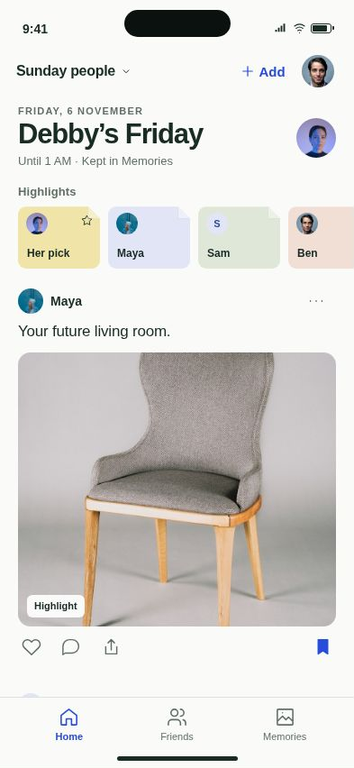 | 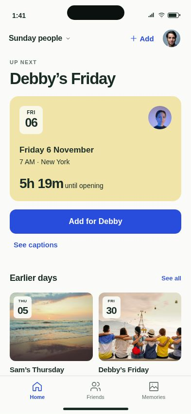 |
| `H01-open` | `H01-waiting` |

## p2 · 01 Study the task, not the styling.

*A successful app is evidence that a product found an audience. It is not proof that copying its interface causes success.*

### The core sample

Locket, Retro, Yope, BeReal and FamilyAlbum cover quick photo exchange, weekly reflection, expressive private groups, synchronized participation and a lasting shared archive. Their current US App Store listings show substantial review volume: roughly 586K, 18K, 11K, 1.2M and 380K ratings respectively. These snapshots establish relevance for this review; they are neither active-user counts nor proof of profitability. [R01–R05]

### Additional benchmarks

Snapchat is an interaction benchmark for capture, recipient selection and returning to a media context, rather than Tadayo’s direct positioning model. Apple’s 2025 awards provide craft references: CapWords for a memorable task-linked transformation; Lumy for a restrained palette and glanceable widgets; Denim for polished movement around a narrow purpose. These are design lessons, not features to transplant. [R06, R07]

### How the review was conducted

For each product, inspect the published entry point, dominant content unit, person/audience cues, primary action, time representation, navigation, archive, expressive layer and pressure mechanisms. Compare screenshot geometry with official feature descriptions. Promotional screenshots demonstrate selected states and may lag live builds; unobserved behaviour is marked as an inference.

### Boundaries

No exhaustive census of every successful photo app is possible here. The sample spans the main relevant interaction models. No retention uplift is attributed to an aesthetic without an experiment. Krets and Rewind are not used as proof of durable business success. The study prioritizes transferable decisions over feature inventories.

## p3 · 02 What the strongest photo apps teach.

*The content unit is recognizable before a person learns the rest of the app.*

### Locket / direct and immediate

The official listing centres the widget-to-camera-to-send loop, reactions without public counts and photo history. Public screenshots foreground a personal photo with a few strong controls. Lesson: make the next useful gesture obvious. Tadayo translates that into a labelled Add action and a fast share extension. It keeps scheduled reveals and does not copy instant delivery. [R01]

### Retro / time becomes a container

The listing describes a weekly journal, camera-roll selection, optional captions and private likes. Published screens organize personal photos into date-based strips and friend cards. Lesson: a collection has value beyond the latest update. Tadayo uses recognizable day/date covers and a strong Memories destination, without importing profile statistics or five destinations. [R02]

### Yope / the group feels like its people

The current listing emphasizes private circles, fast sharing, lock-screen presence, photo chats and streaks. Published images show strong personal imagery and expressive presentation. Lesson: photographs and names can carry identity. Tadayo uses a consistent day accent and member imagery, while retaining its explicit ban on streaks, rankings and public profiles. Current Yope marketing can differ from older collage-wall coverage. [R03]

### The synthesis

Use a recognizable object, an obvious action and a reason to revisit. For Tadayo, that object is a person’s dated day. Avoid importing another app’s entire growth model just because one screen looks compelling. The relationship should stay visible when the chrome is removed.

## p4 · 03 Ritual, response and an archive.

*The best borrowings are often small: where a name appears, how a date reads, what happens after a tap.*

### BeReal / one unmistakable occasion

Official materials describe the shared daily capture occasion, dual-camera format and friend responses. Its visual signature is tied to the capture task. Tadayo needs equally clear identity around the day, but its fixed window should not become a countdown emergency. No lateness label, obligation to post or public-discovery surface is added. [R04]

### FamilyAlbum / understand across generations

The official site demonstrates month-organized albums, comments, private invitations and a Memories hub. The experience emphasizes browsing and time organization. Tadayo borrows legible dates and predictable revisiting; it does not borrow visitor tracking. Received content should be easy to find without knowing which notification originally opened it. [R05]

### Snapchat / learn from contextual efficiency

Official help separates capture, Chat and Send To. The useful lesson is a short path from an existing object to the intended people, with a clear return route. Tadayo’s share extension therefore asks for club, person and exact occurrence before commit. It does not adopt gesture-only discovery, disappearing memories or screenshot receipts. [R06]

### What the review does not establish

Neither public screenshots nor download totals show that a beautiful interface alone creates a lasting friendship habit. The design can reduce effort, increase comprehension and make each reveal satisfying. Continued voluntary contributions and comfort being the star remain independent product questions.

## p5 · 04 “AI-generated” is not one visual style.

*Changing purple to beige does not create an original product.*

### Published builder examples inspected

Vercel v0: Calendar App, the event/lanyard landing preview and Optimus. Their public previews span a colourful calendar, a dark graphic event page and a sparse monochrome site. Bolt: Infinite canvas gallery, a dark spatial browsing experiment with an introductory sequence. Lovable: Inspo’s public preview, plus Reflection Journal and Masonry Photo Gallery’s published anatomy and available deployment metadata. Visual inspection of the latter two was limited; no live task completion is claimed. [R08–R13]

### What the sample shows

The examples are diverse. Some already use careful typography, photographic collage and restraint. There is no reliable colour, typeface or component that proves AI authorship. This is a purposive qualitative sample, not a measured prevalence study or an authorship detector. v0 itself recommends explicit constraints and taste; shadcn’s components are customizable foundations, not inherently poor design. [R14, R15]

### The practical risk for Tadayo

An interchangeable shell: a greeting, feature cards, numerical activity summaries, a generic add button and stock content could be reskinned into a finance or wellness app. Another risk is a beautiful first screen with no coherent cutoff, empty, error or accessibility states. Those are design failures regardless of who wrote the code.

### The response

Build around a particular object and rhythm. Tadayo repeats a date marker, a person’s name and one folded-card geometry across the waiting feed, reveal, archive and widget. Real content determines space. Every action has a defined destination, receipt and recovery. The visual rules below are specific enough to prevent a builder from filling gaps with unrelated patterns.

## p6 · 05 Visual direction

*The day is recognizable; the photographs stay central.*

### Hierarchy by task

An open day has a compact identity header, a 69-point highlight rail and a readable first photograph above the bottom navigation at default size. Friends uses stable rows; Memories uses a date-labelled grid. Each layout serves its task rather than repeating a poster, card and button.

### The recurring detail

Use one small weekday/date plaque and one consistent folded corner. A folded card marks hidden content; a lock appears only before reveal. A labelled star marks the sender’s selected Highlight. Ordinary revealed photos open directly; only selected highlights receive the optional fold animation. Cover colours are independent of hidden photos and never encode popularity or permission.

### Colour and type

Canvas #FAFBF8, ink #182B25, secondary #607067, action #284CDB and a restrained #F0E4A8 day accent. Native system type is the production default. The portable reference embeds Arimo for consistent rendering; it stands in for native typography.

### Content treatment

Photographs retain their original colour. Feed previews have a predictable viewport; the full viewer preserves the whole frame. Show a text screenshot, portrait, landscape, no caption and a dark ordinary image in design review. Avoid artificial grain, permanent tilt and decorative treatments that overwhelm the friends’ content.

## p7 · 06 Navigation

*Three stable destinations and one labelled Add action.*

### Home

Home directly displays the active person’s day. Between windows, the next person, exact date and opening time lead, with a secondary countdown. There is no extra Open day gate. A quiet day retains its identity and recent memories remain reachable.

### Friends

Show the selected club’s roster in stable order with each next collecting date. Mark the current member with You. A small Next up label helps without reordering people or measuring participation. The example consistently assigns Ben Monday and Debby Friday.

### Memories

Past days grouped by month, with person filtering, Favourites and search inside this destination. Each tile names the person, original weekday and date. Favourites is private and remains subject to the original drop’s access rules.

### Secondary places

Add opens the explicit club/person/date picker. Contextual Add keeps its chosen target visible. The club name opens switching and club details; the avatar opens account settings. Private drafts has a prominent row at the top of Friends and an Open my drafts link in the Add picker. Club details, the composer and author management retain secondary routes. Tab state and scroll position survive ordinary return navigation. [R16]

## p8 · 07 Names and copy

*Familiar labels carry the navigation. Names and photographs carry the feeling.*

### Destinations

Home, Friends, Memories, Favourites, Drafts and Club details. The upcoming occasion is Debby’s Friday with its exact date. Drop names one contribution; Highlight names a selected contribution. Your pick refers to the star’s chosen highlight.

### Actions

Add for Debby, Choose a photo, Save changes, Save as draft, See captions, Make my highlight, Open original, Save to Favourites and Withdraw drop. A highlight cover itself has the accessible action Open Maya’s highlight. It does not lead to another confirmation poster.

### Time and audience

For Debby · Friday 13 Nov / Sunday people · Opens at 7 AM. Caption visible to Sunday people now. Photo opens Friday 13 Nov at 7 AM. When today’s cutoff passed, say next Friday and give the exact date. Never rely on a weekday alone.

### Voice

Use direct copy on settings, errors and receipts. Added for Debby’s Friday is enough. Quiet days say Nothing added for this day, rather than addressing the wrong viewer or announcing missing contributors. Avoid invented sentiment, staged enthusiasm and an emotional slogan on every utility screen.

## p9 · 08 Welcome and invitation

*One labelled example explains the experience before the user meets the real roster.*

### Welcome

A caption card for Debby’s Friday sits beside its revealed chair photograph. Example and the two stages are explicit. Create a club and I have an invite are the primary routes. A received invite skips the generic introduction.

### Invitation

Name the inviter, proposed club and exact roster, including the candidate once. Ben is consistently the candidate/current user in this example. Explain that joining starts access to newly submitted drops, including future reveals; historical media is not inherited.

### Recovery

Expired, changed or pending invitations retain their intent through authentication. Everyone accepts the same roster before activation. No photo-library, notification or contacts permission is required to review an invitation.

| 01 / Welcome | 02 / Join club |
|---|---|
| 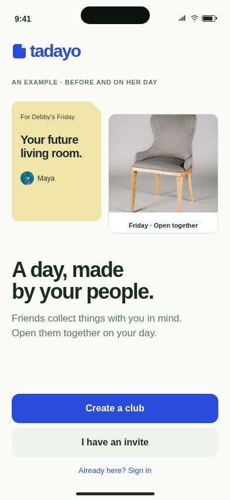 | 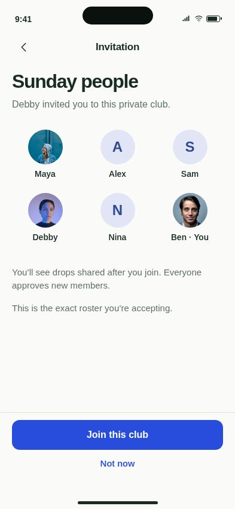 |
| `A01-welcome` | `G02-invitation` |

## p10 · 09 Confirm a day and add one thing

*One contribution demonstrates the behaviour without filling an allowance.*

### Shared calendar

In the six-person example Ben confirms Monday. Show the week, club timezone and 7 AM to 1 AM next morning. Two- and three-person clubs instead choose two weekdays; the separate two-day state shows occupied slots and spaced suggestions.

### First contribution

The illustration is Friday 6 November after opening. Debby’s next collecting day is Friday 13 November. Make that date explicit; one ordinary photo is sufficient. The example and idea helper provide a starting point without writing the user’s caption.

### Permissions and truth

Ask for photo selection only after Choose a photo. After a genuine first receipt, offer notifications and a truthful widget preview, both skippable. The prototype simulates those OS surfaces. Do not fabricate a received photo or provide an instant first reveal.

| 03 / Confirm day | 04 / First drop |
|---|---|
| 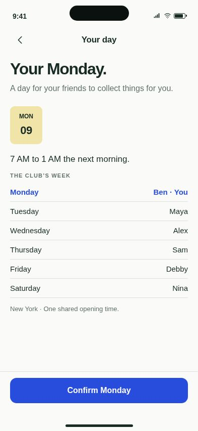 | 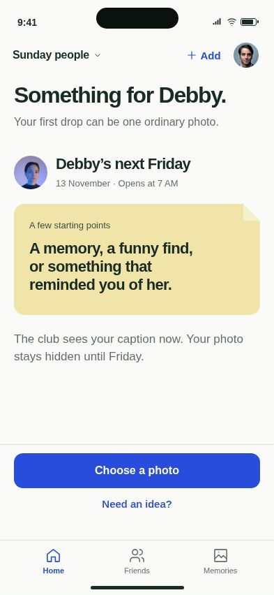 |
| `G04-one-day` | `H01-first-drop` |

## p11 · 10 Recipient choice and two weekly days

*The two most consequential choices are visible before content leaves the composer.*

### Recipient picker

The selected club leads. Every member row shows their next collecting date. During Debby’s open Friday, her next Friday is the 13th. Ben’s own row is You. There is no remembered-recipient auto-send.

### Two-day schedule

Pairs and three-person clubs select two available weekdays per person. Occupied days identify their owner; the confirmation enables only for two choices. Spaced proposals are helpful, not an engagement-driven rescheduling rule.

### Consistency

A change from three to four members follows the existing versioned schedule process. Submitted occurrences retain their promised dates. Neither this picker nor a club switch can rewrite their historical audiences.

| 31 / Recipient picker | 32 / Pair schedule |
|---|---|
| 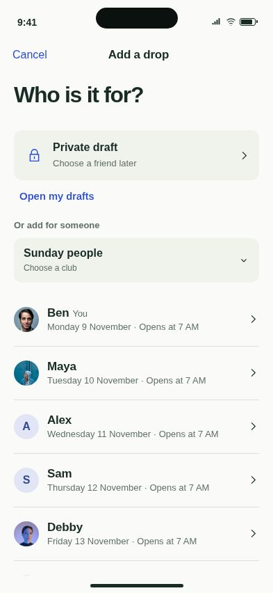 | 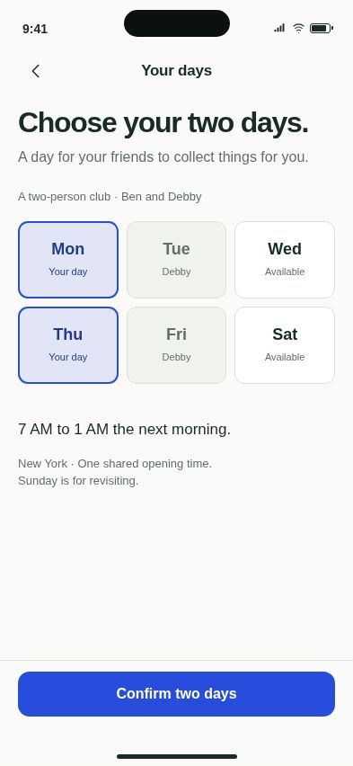 |
| `C01-picker` | `G04-two-days` |

## p12 · 11 Home during and between days

*The day is immediately browsable. A waiting screen gives the next useful choice.*

### Open Home

Friday 6 November at 9:41 AM displays Debby’s feed directly. The day header and compact highlight rail leave the whole first feed preview visible at default size. Star pick leads; other highlights follow stable roster order. No empty contributor slots are shown.

### Waiting Home

The second fixture is Friday 6 November at 1:41 AM, after Thursday closed and before Debby opens. Name Friday 6 November, 7 AM New York before the 5h 19m countdown. Add and See captions target that exact collecting occurrence.

### Safe transitions

Resolve the clock from the server in production. At 7 AM update the available region without moving someone away from a caption they are reading. At 1 AM change Home on safe return; an open authorized photo stays readable. Waiting and revealed examples are labelled independent fixtures in the reference.

| 05 / Home open | 06 / Home waiting |
|---|---|
|  |  |
| `H01-open` | `H01-waiting` |

## p13 · 12 People and collecting captions

*Choosing a person always exposes the next collecting date.*

### Stable roster

The profile is Ben; Ben’s row says You and Monday 9 November. All six members keep their positions while Nina’s Saturday is marked Next up. Date changes update labels without ranking or reshuffling friends. The roster is scoped to the selected club.

### Upcoming day

Debby’s Friday means 13 November in the active-Friday fixture. Folded cards show caption first, sender underneath and a quiet exact opening date. Their height follows text, with a 151-point minimum at default size. Blank captions use neutral Photo for Debby copy and smaller text. Colours follow stable sender positions and never hidden media.

### Private author tools

Your drops contains only the current author’s previews, edits, selected highlight and withdrawal. A future room never exposes another sender’s media or source identity. Joining later cannot inherit previously submitted captions or future-revealed media.

| 07 / Friends | 08 / Upcoming captions |
|---|---|
| 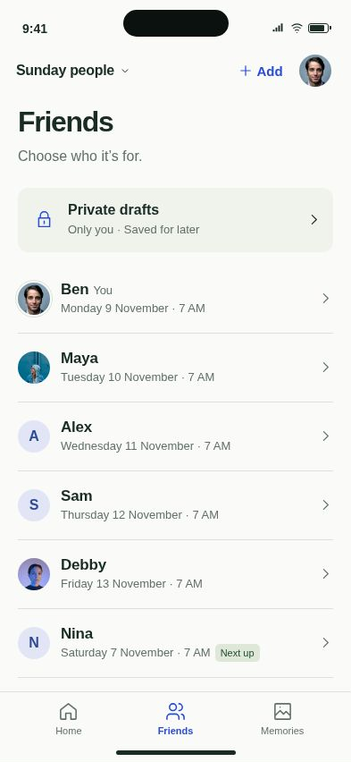 | 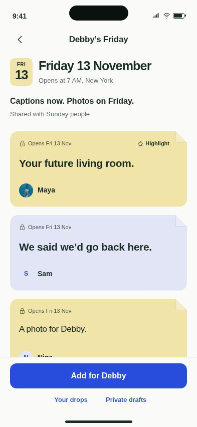 |
| `F01-friends` | `F02-upcoming` |

## p14 · 13 Choose a source and a photo

*A known target stays visible while the user chooses what to add.*

### Source choices

Choose a photo, Take a photo and Paste a video link are ordinary labelled rows. A photo is the default path. Source choice does not add another navigation tab or require a caption.

### System picker

The native app uses the OS photo picker and requests camera access only at use. The portable reference presents embedded example photos. Selecting one visibly changes the current choice and returns to the composer for review.

### Several items

Production multi-select counts each item separately and provides caption review and partial-failure receipts. A Live Photo is one contribution; standalone uploaded video remains outside v1. The single-photo reference does not pretend to implement the device library.

| 37 / Source chooser | 38 / Photo picker |
|---|---|
| 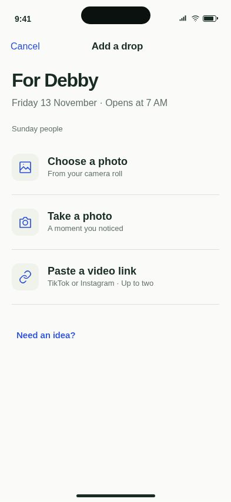 | 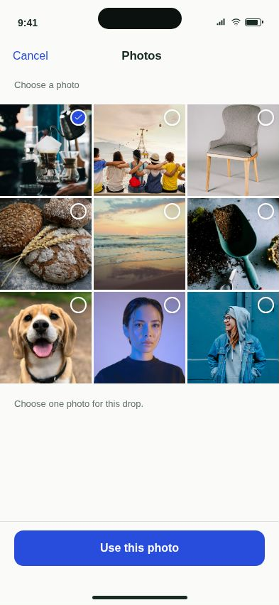 |
| `C03-sources` | `C03-system-picker` |

## p15 · 14 Compose and confirm

*Recipient, club, date and editable caption form one understandable decision.*

### Composer

The target block names Debby, Friday 13 November, Sunday people and 7 AM. Caption is visibly labelled Optional. The author sees their photo and can change it. Audience copy names the club rather than relying on a vague group reference.

### Repeat contribution

Only the ready server commit becomes Added in production. The compact receipt appears in the originating context, naming person and full date. A first contribution may receive additional onboarding guidance, but repeated sends do not require a full-screen celebration.

### Highlight and limits

Make my highlight is optional and does not add another contribution. Six total includes at most two external links. Allowance is quiet and private; no public empty slots or completion ring appears. A pending transfer retains its draft and never shows a success receipt early.

| 09 / Photo composer | 10 / Added receipt |
|---|---|
| 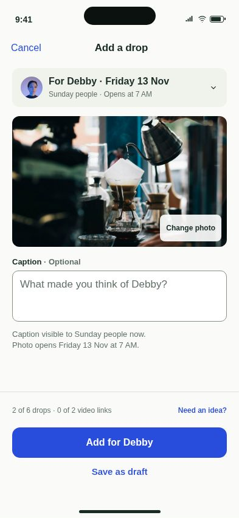 | 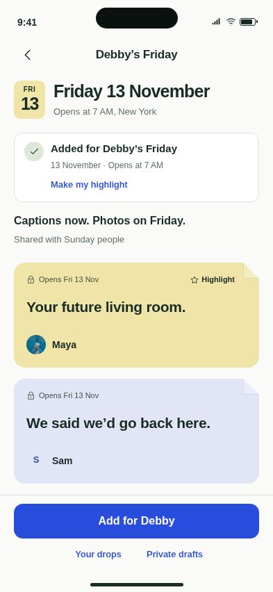 |
| `C02-photo` | `F02-added` |

## p16 · 15 Keyboard and pending submission

*The interaction must work while writing and while waiting for confirmation.*

### Writing

The image becomes shorter when the keyboard is present. The recipient, club, exact date, editable caption, visibility disclosure and Add control remain reachable. Native safe-area and keyboard APIs determine the real layout.

### Pending

Uploading names the intended occurrence and says Not added yet. The user can retain a draft. Media preparation and ready commit are separate production states, and only a ready commit produces the durable receipt.

### Boundaries

If the target closes before commit, preserve the work and ask about the next date. If a previously committed request is retried, return its original receipt. The reference’s local timer is a simulation and proves neither transfer speed nor backend reliability.

| 33 / Keyboard composer | 34 / Uploading |
|---|---|
| 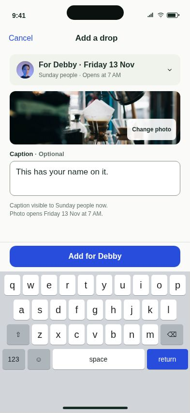 | 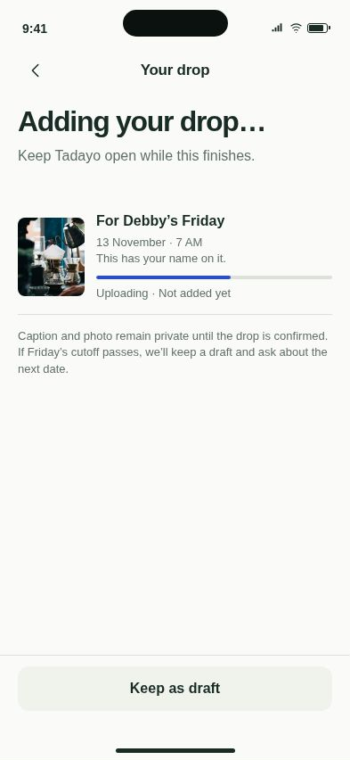 |
| `C02-keyboard` | `C07-uploading` |

## p17 · 16 Share from another app and manage your drops

*The source app remains the place where a find happens.*

### Share sheet

From a compatible source choose Tadayo, club, explicit person/date, optional caption and Add. The link is supplied by the source; the sender sees its provider. Other viewers see only the allowed caption before reveal. No forced app-Home visit or highlight decision follows.

### Private management

Two-column author previews show captions and the selected highlight. Edit is reachable; a 44-point More control contains highlight replacement and withdrawal. Highlight selection is a pointer to one existing drop, not a copied object or seventh slot.

### Receipts and recovery

Return to the source after confirmation when the OS permits. The HTML reference simulates this boundary and says so outside the product screen. An unavailable session or upload remains private draft work; retry, quota and missed-cutoff flows are separate states.

| 11 / Share extension | 12 / Your drops |
|---|---|
| 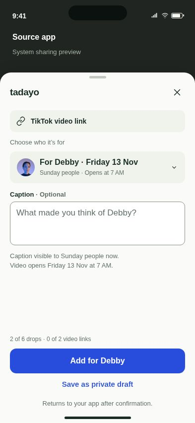 | 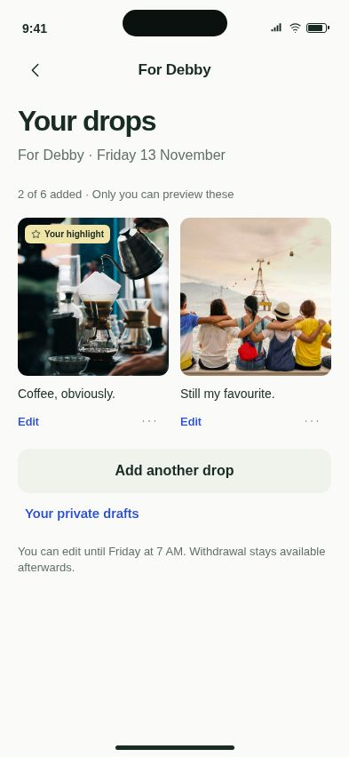 |
| `C04-link` | `F02-your-drops` |

## p18 · 17 Recover a transfer and view a video

*Failure preserves work; provider viewing stays contained.*

### Transfer failure

Your photo is safe explains what remains. Retry resumes the same intended submission while valid; Save as draft retains media and caption. A missed cutoff is a separate explicit date-review flow rather than a generic retry loop.

### Video viewer

The preview reserves a provider area after reveal, names the sender and gives access to the discussion. Tap loads TikTok’s official developer example. The player is not reproduced with fake controls or a rehosted video.

### Production contract

Use one active official embed, preserve provider controls, pause on close and keep Open original available. Login, region restrictions and removed sources can prevent playback. The static screen shows the entry state; it is not evidence of a successful native embed. [R20, R21]

| 35 / Upload failed | 36 / Video viewer |
|---|---|
| 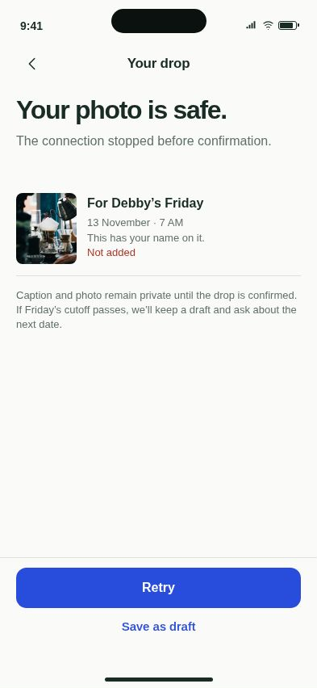 | 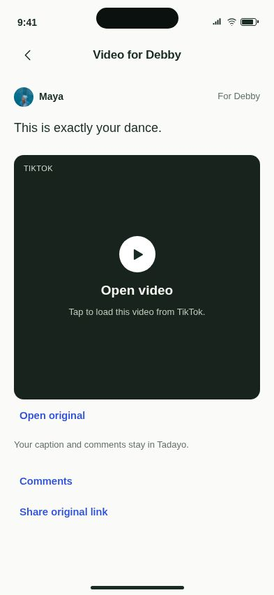 |
| `C07-failed` | `E01-entry` |

## p19 · 18 Highlight opening and photo viewing

*A direct tap gives one small flourish and then the photograph.*

### Direct opening

Tapping a highlight starts the local 650 ms fold without a second Open screen. The cover’s button has an explicit accessible name. Skip animation and reduced motion reveal immediately. Reopening a previously viewed highlight reaches the photo directly; local animation state is never a read receipt.

### Full photograph

The viewer preserves the entire image frame and exposes the author, caption, recipient and date. React, Comment and private Favourites stay attached to this drop. A sender cannot react to their own contribution. Back returns to the originating feed position.

### Availability

At the scheduled reveal the ordinary feed is already readable. Wrapping is emphasis, never a gate for the rest of the day. Removing a drop removes its highlight entry and access through Favourites. A viewer can zoom without a precise gesture being the only route.

| 13 / Highlight opening | 14 / Photo viewer |
|---|---|
| 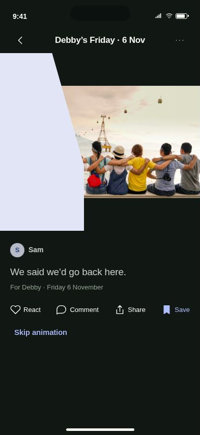 | 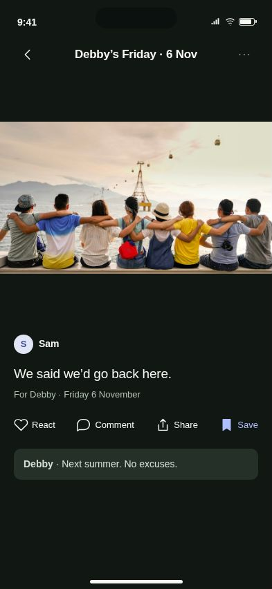 |
| `R03-opening` | `R02-photo` |

## p20 · 19 Comments and unavailable video

*Responses have a clear audience; failed media still has a useful state.*

### Comments

A sheet stays anchored to the drop. It states that comments follow the drop’s audience, contains optional text entry and an accessible send control, and returns to the same photo. No generic chat inbox, compulsory response or opened status is introduced.

### Unavailable video

The failure state contains an unavailable icon, explanation and Open original. It contains no play triangle that falsely promises playback. Keep the authorized caption and discussion even if the provider removes the source.

### Working viewer contract

A separate video-viewer state reserves the official provider frame and loads it only on tap. The portable reference uses TikTok’s official developer sample; network playback may fail. No successful mobile WebView integration is claimed. Meta and TikTok adapters require real-device validation. [R20, R21]

| 15 / Comments | 16 / Video fallback |
|---|---|
| 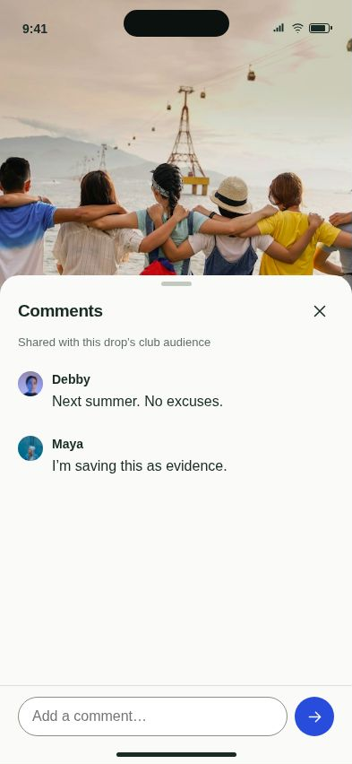 | 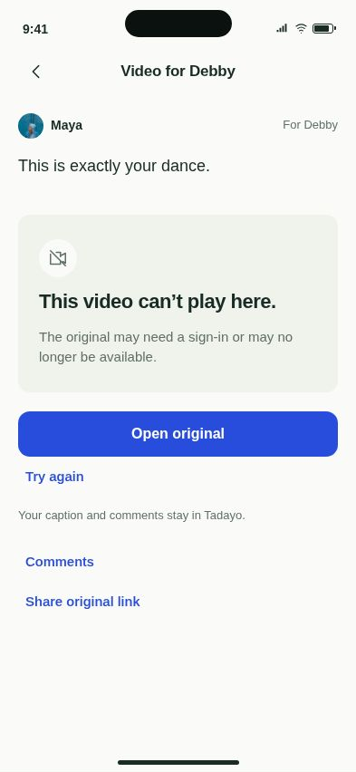 |
| `R04-comments` | `E01-unavailable` |

## p21 · 20 Memories and private Favourites

*The archive is useful with ordinary weeks and years of history.*

### Browse by month

Compact date-labelled tiles show several past days at once. Each has a person, weekday and exact original date. A month selector, person filter and authorized text search remain within Memories. A day reopens the same finite feed without repeating reveal ceremony.

### Favourites

Bookmarks are private pointers to accessible drops. Show the author and original person/day. Saving creates neither public counts nor an independent media copy. Withdrawal, club-wide removal and lost membership revoke access here as well.

### Sparse history

New members see only eligible content submitted after joining. Before the first accessible reveal, explain the real future date. Empty Favourites shows a simple instruction. A quiet week can be enjoyed through existing memories without fabricated activity.

| 17 / Memories | 18 / Favourites |
|---|---|
| 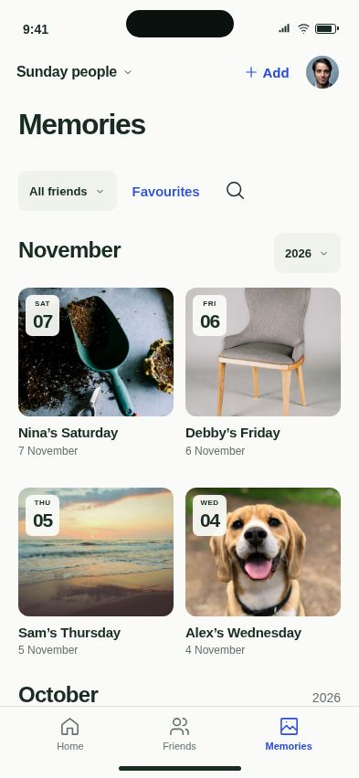 | 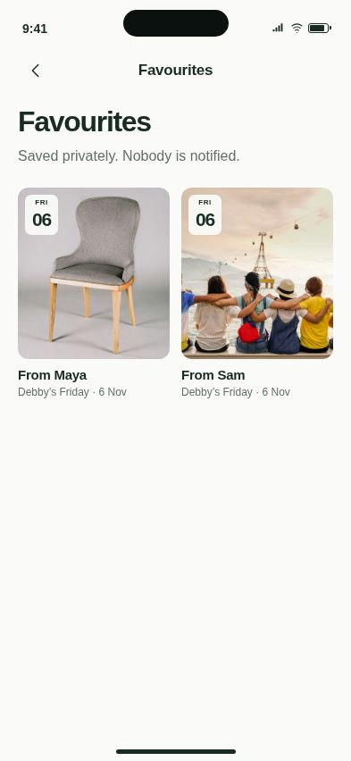 |
| `M01-memories` | `M02-favourites` |

## p22 · 21 Drafts and finding a memory

*Private preparation and published history remain distinct.*

### Drafts

Private drafts is an account-level private collection. A photo or video link can have no recipient, club or date. Add offers Private draft before the friend list. Drafts remain editable and do not use drop slots or notify anyone. Optional intended targets remain labelled. Choose a friend exposes an explicit club and exact collecting date before a separate Add confirmation.

### Search

Search authorized names, original dates and caption text inside Memories. Results identify the person and day before opening. No result exposes pre-join, removed or hidden source material. Broader semantic search remains later work.

### Return context

Opening a result returns to the same search state. A source disappearing can keep its authorized caption and unavailable-link state. Losing access removes the corresponding preview from results and Favourites.

| 39 / Drafts | 40 / Search Memories |
|---|---|
| 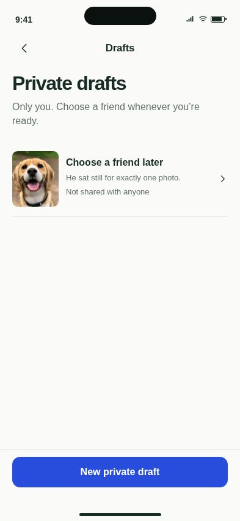 | 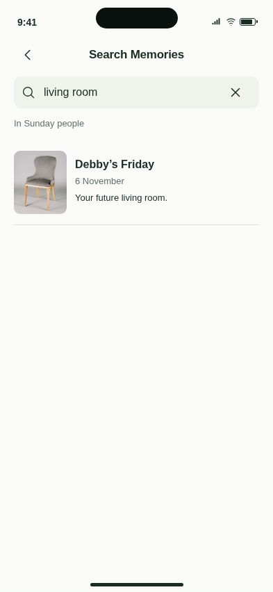 |
| `C05-drafts` | `M01-search` |

## p23 · 22 Past days and new history

*The original day remains findable and new members start with a clear boundary.*

### Past day

An archive tile opens that exact day and original date. Its surviving drops use the familiar feed; a photo and its comments return to that same archived position. The old day never masquerades as the current Home occasion.

### New history

A new member receives a truthful empty archive and the next scheduled date. Previously submitted content is excluded, including drops that reveal after joining. No example is inserted into the actual club as a fabricated memory.

### Context

The reference keeps archive date and club context through viewing, comments and return navigation. The native backend must independently enforce those per-drop audience rules.

| 49 / Past day | 50 / No history |
|---|---|
| 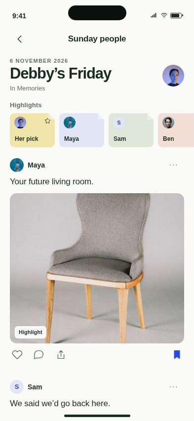 | 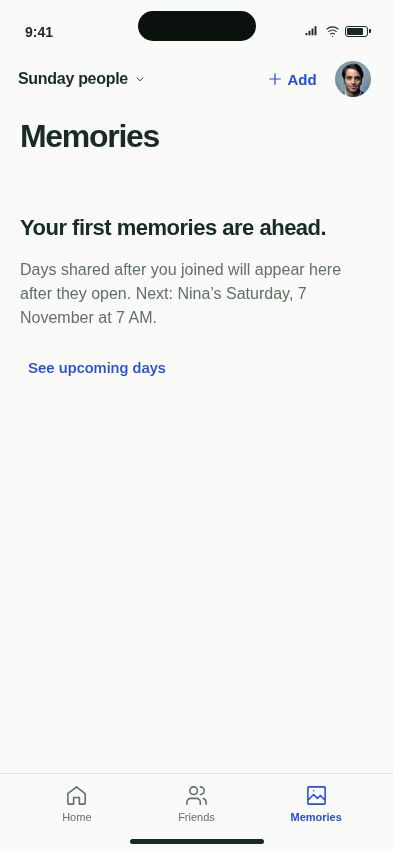 |
| `R01-past-day` | `M01-empty` |

## p24 · 23 Ideas and club details

*Small editorial help stays separate from administration.*

### Curated assistance

Need an idea? shows the agreed three starting directions and concrete examples. More ideas advances through curated batches, retaining media and caption underneath. It never inserts a claim of feeling, assigns a task or labels the resulting drop as a prompt response.

### Club details

Members, Schedule, Notifications, Widget and Drafts use familiar rows. The displayed club, count and roster agree. A full six-member club offers no extra member invitation. The five-member Kitchen table fixture handles Leila’s unanimous approval separately.

### Context

Personal account controls live under the profile avatar. Changing clubs keeps the account’s private drafts and requires explicit review of any intended target. Unassigned drafts have no club audience. A photo from one club never becomes shared with the other because a picker was remembered.

| 19 / Ideas | 20 / Club settings |
|---|---|
| 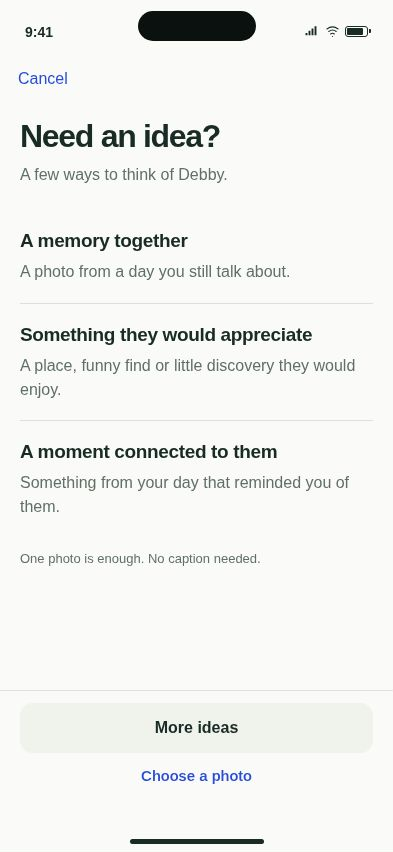 | 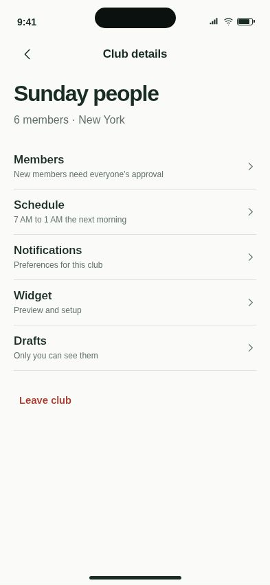 |
| `C06-ideas` | `G05-club-details` |

## p25 · 24 Quiet days and missed cutoff

*Clear factual recovery makes ordinary use comfortable.*

### Quiet day

Keep Debby’s Friday and its date. A modest Nothing added for this day message and a prior-memory link are enough. Do not address Ben as the star, fill the screen with missing-contribution language or promote another person early.

### Missed upload

State that the photo was not added to Friday 6 November and that the media and caption are safe. Offer review of Friday 13 November as a new explicit target. Never silently move an unfinished upload or call a preserved draft sent.

### Cutoff default

This visual revision retains D02: the 7 AM reveal is also the submission cutoff. An Add action during an open day targets the next collecting occurrence. Exact-date labels make that behaviour explicit. The trial should still test whether this default matches users’ expectations.

| 21 / Quiet day | 22 / Missed cutoff |
|---|---|
| 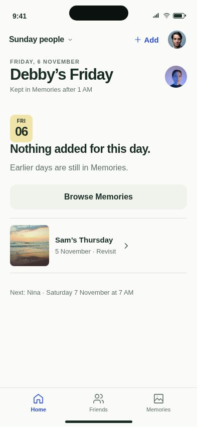 | 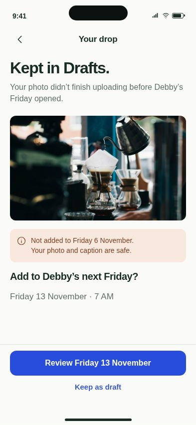 |
| `H01-quiet` | `C07-missed-cutoff` |

## p26 · 25 Dark appearance and larger text

*Typography and contrast retain their meaning as the presentation changes.*

### Dark system

Deep neutral green-black surfaces, warm readable text and a lighter cobalt action colour. Photos stay unfiltered; pale folded covers keep dark ink. Semantic tokens include their foreground pairs rather than applying global opacity.

### Growing layouts

Rows grow and dates wrap. Large-text highlights become vertical and memory grids become one column. Narrow names wrap without forcing smaller type. The reference includes enlarged Friends and long-name fixtures; the native implementation must use system Dynamic Type or Android scaling.

### Access

Use native controls and focus order, 44-point iOS or 48-dp Android regions, accessible icon names and non-colour status labels. Countdowns announce the target date instead of speaking every minute. Token contrast and browser checks do not constitute a completed native accessibility audit. [R17, R18, R19, R28]

| 23 / Dark Home | 24 / Large text |
|---|---|
| 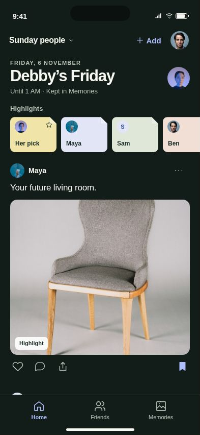 | 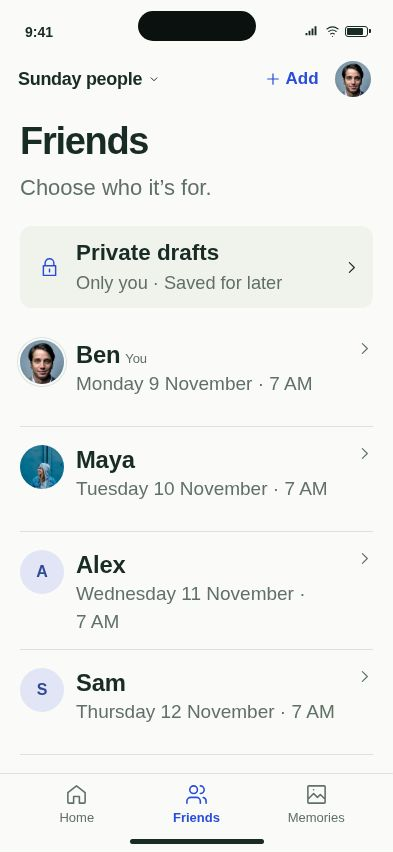 |
| `H01-open-dark` | `F01-friends-xl` |

## p27 · 26 Long names and text screenshots

*Ordinary difficult content is part of the design.*

### Long-name fixture

The Friends specimen uses Alexandria-Rose Mensah and Deborah-Anne Ouédraogo. Names wrap and rows grow; the date and navigation remain legible. Localization must not silently shrink meaningful text to preserve a fixed card.

### Screenshot fixture

A fictional shopping-list screenshot is presented with its complete frame and an enlarge action. Text remains readable without a permanent feed crop. The screenshot is an explicitly constructed example, not a real private message.

### Review sizes

Check 320-, 393- and 430-point widths as well as larger native text sizes. Browser overflow checks are included in the quality record. Native VoiceOver/TalkBack, zoom and focus order require platform review.

| 41 / Long names | 42 / Screenshot photo |
|---|---|
| 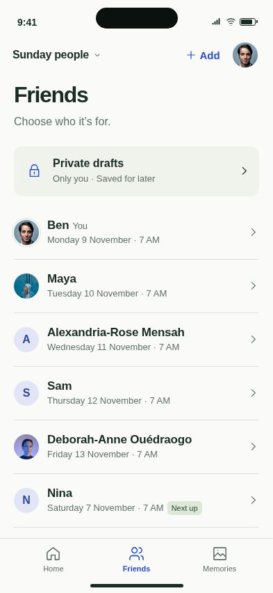 | 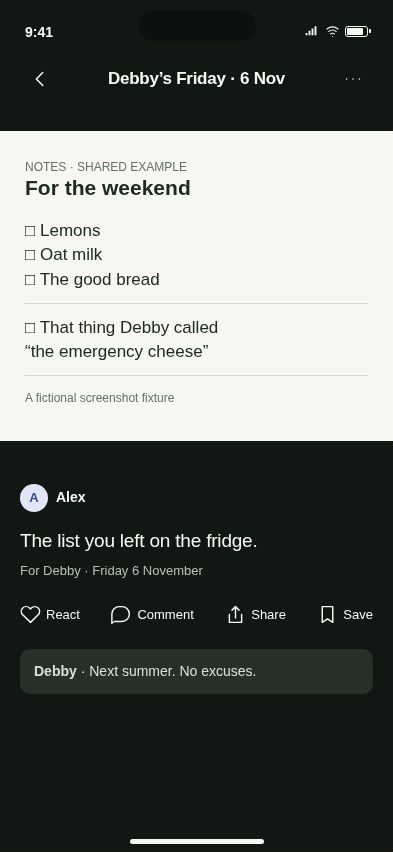 |
| `F01-long-names` | `R02-screenshot` |

## p28 · 27 Widget and photo control

*A glance stays truthful and removal remains understandable.*

### Widget dates

Person, absolute date and opening time lead the waiting preview. Avoid cached Opens tomorrow text. During a day the eligible star photo pick leads under the existing priority rule; date and identity stay visible if a snapshot becomes stale.

### Setup and refresh

Show native setup steps and choose one club per widget. Privacy can replace photos with identity; caption previews start off. App Home is authoritative because OS refresh timing is outside Tadayo’s control. [R23]

### Pictured-member removal

A pictured member may remove the photo club-wide without a public explanation. Explain access changes in highlights, Favourites and future widgets, confirm the action and notify the star neutrally. Other members retain report and personal-hide routes.

| 25 / Widget | 26 / Removal |
|---|---|
| 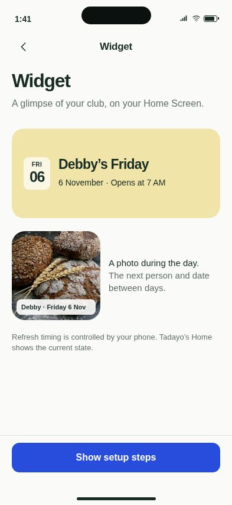 | 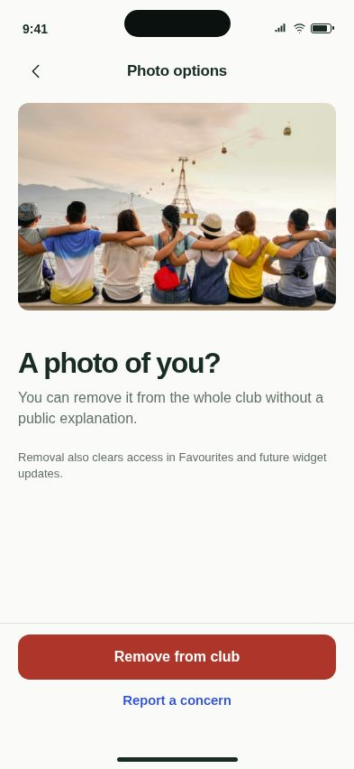 |
| `W01-setup` | `S01-pictured-removal` |

## p29 · 28 After closing and on Sunday

*Home changes its focus while the archive retains the day.*

### After 1 AM

Saturday 7 November at 1:01 AM shows Nina’s Saturday and a 5h 59m countdown. Debby’s Friday is explicitly available in Memories. Nothing expires merely because the day leaves Home.

### Sunday

Sunday 8 November at 9:41 AM shows Ben’s Monday, 9 November at 7 AM, and 21h 19m until opening. A selective revisit of the week is secondary. Sunday does not manufacture a reveal or ask people to catch up.

### Across timezones

Each club has one IANA timezone and one shared opening instant. Travelling members see their local equivalent with the club zone available. Resolve DST and both civil boundaries independently. Preserve announced submitted occurrences during schedule changes.

| 27 / After close | 28 / Sunday |
|---|---|
| 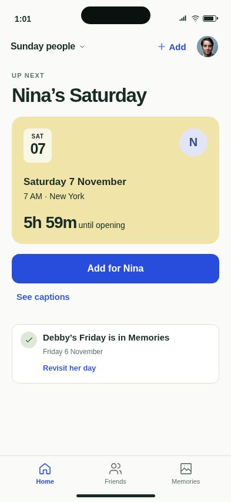 | 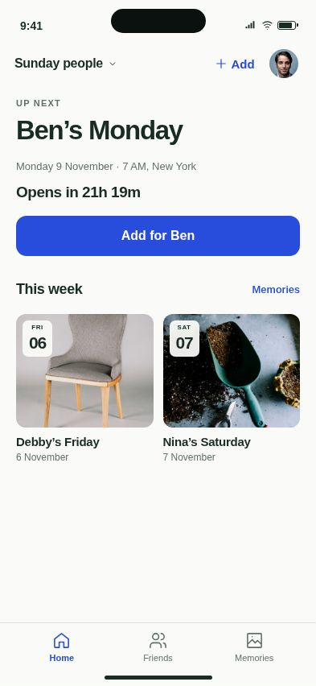 |
| `H01-after-close` | `H01-sunday` |

## p30 · 29 Your own day and membership approval

*The star participates equally and the audience stays deliberate.*

### Ben’s Monday

The current viewer is Ben, the date is Monday 9 November, and his own selected highlight is Your pick. His ordinary photos have the same six-drop allowance and reveal policy. Add targets his next Monday, not the frozen open occurrence.

### Leila’s invitation

Kitchen table has five existing members and room for a sixth. Each current member approves the exact proposed roster; Leila accepts that roster. Avoid claiming absolute secrecy about choices: explain that Tadayo does not identify who declined.

### Audience boundaries

Joining does not grant previously submitted captions or media, even for future reveals. The new interval starts at joining. Leaving, blocking, withdrawal and account deletion follow the existing v3 rules; no visual shortcut changes historical access.

| 29 / Your day | 30 / Member approval |
|---|---|
| 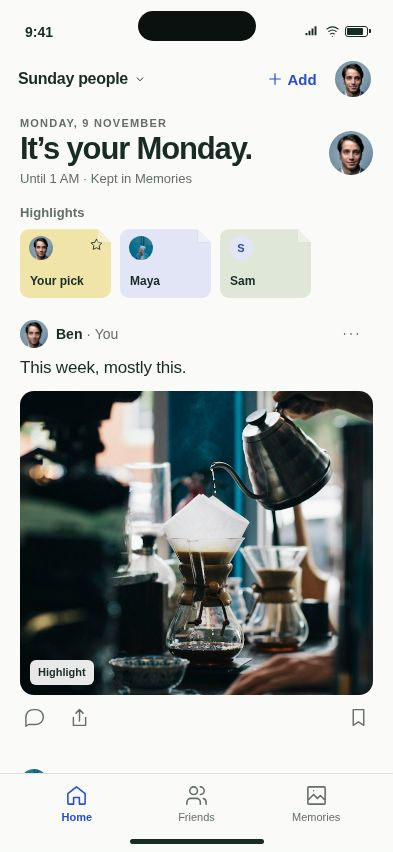 | 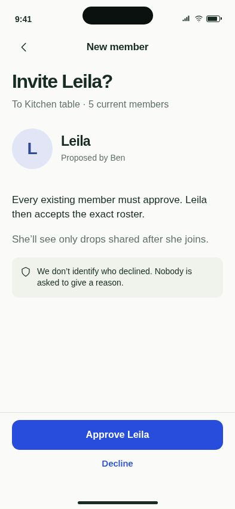 |
| `H01-your-day` | `G03-approve` |

## p31 · 30 No caption and a full allowance

*An optional field stays optional, and a limit never discards work.*

### No caption

Author and photograph remain a complete contribution. Do not insert a generated joke, an Add a caption demand or an empty text field in the revealed feed. Attribution and date still explain where the photo belongs.

### Allowance reached

Name Debby’s Friday and its exact date. Explain six total and at most two external links only where relevant. Offer the existing author tools and retain the new photo as a private draft.

### Highlight

A highlight is selected from the same six. Replacing it changes only the pointer, not quota, chronology or conversation. Public views never reveal six empty slots or which member failed to contribute.

| 43 / Blank caption | 44 / Limit reached |
|---|---|
| 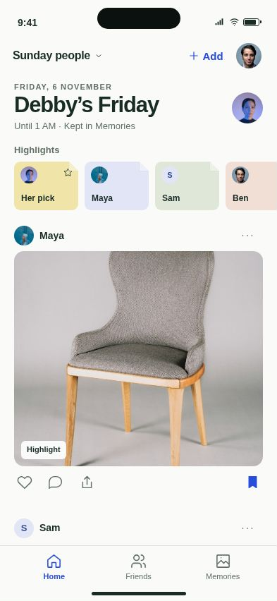 | 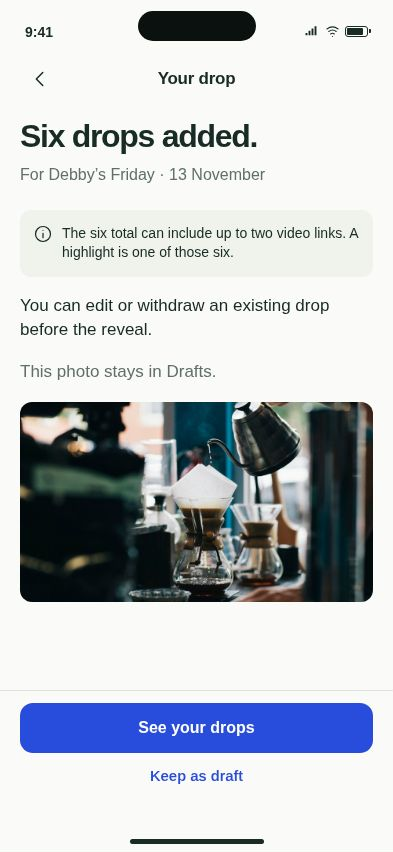 |
| `R01-blank-caption` | `C07-limit` |

## p32 · 31 Club switching and your account

*Personal settings and club context have predictable homes.*

### Switching

The club-name control opens a short list. Each club has its own roster, schedule and history. Private drafts belong to the author; a prepared intended club is a hint, never an audience grant. Choosing another club is explicit. The local reference gives Kitchen table a distinct five-member context rather than relabelling Sunday people’s media.

### Account

Profile, notification preferences, appearance, Reduce motion, safety and account controls use ordinary rows. Administrative actions do not need a large decorative headline. Destructive choices explain consequences before confirmation.

### Native services

Authentication, account deletion, reports and leaving are documented production flows. Prototype sheets identify those actions as examples and do not collect credentials, send reports, change a live membership or imply a deletion occurred.

| 45 / Club switcher | 46 / Account settings |
|---|---|
| 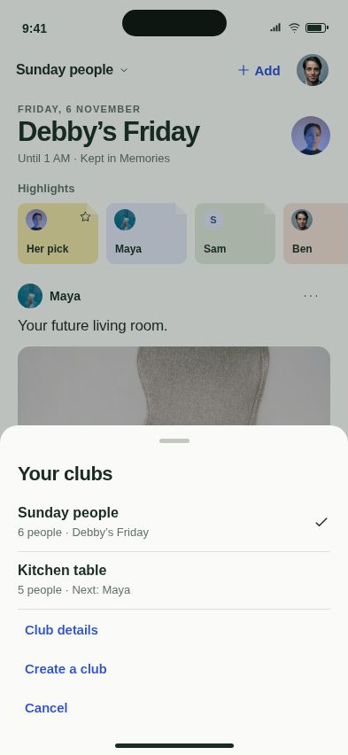 | 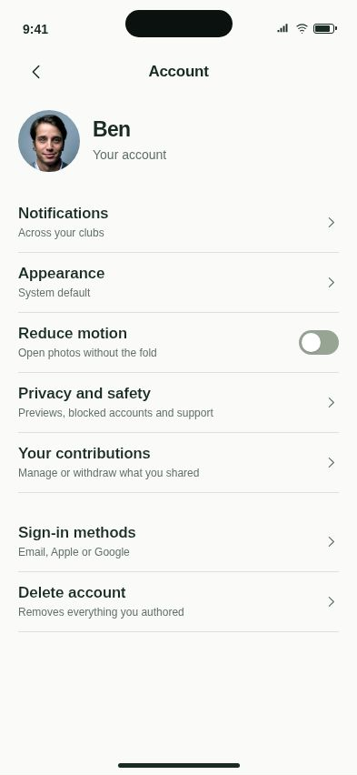 |
| `G06-switcher` | `S03-account` |

## p33 · 32 Create a club and choose updates

*Setup and notifications explain their purpose without pressure.*

### Creation

Name a private club, propose the roster and let every member agree. The club starts with two accepted people; no contact upload is mandatory. Work prepared before activation stays private in Drafts.

### Updates

Day-ready and actual reaction/comment events can be enabled. Caption previews begin off. Quiet hours are 11 PM to 8 AM on the device, and up to two ordinary updates across clubs respect the existing policy.

### Promises

A 7 AM reveal still opens at 7 AM even when its push waits. Quiet days generate no fake ready message, 1 AM closing notification or friendship-maintenance reminder. The app’s visual appeal should not depend on manufactured unread states.

| 47 / Create club | 48 / Notifications |
|---|---|
| 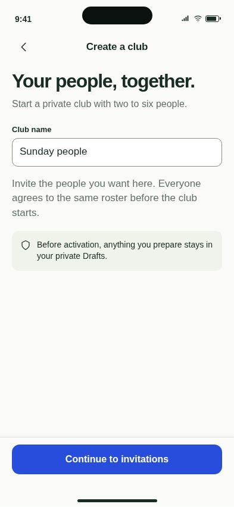 | 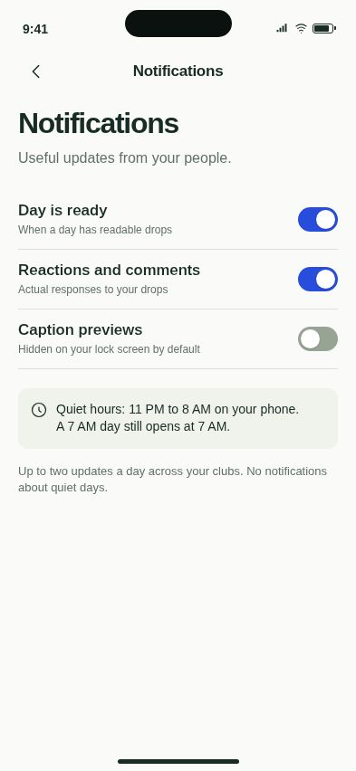 |
| `G01-create` | `S03-notifications` |

## p34 · 33 Component contracts

*A component has one shape, one meaning and explicit states.*

### Day and highlight

The day header combines person, exact date and availability. The 91 by 69-point highlight cover is a button with a concise name and a folded corner. It never inherits colour or hints from hidden media. At large sizes the rail becomes a labelled list.

### Drop states

Private draft, uploading, processing, committed collecting caption, revealed media and removed/unavailable are separate variants. An author’s pre-reveal preview appears only in their tools. Blank captions leave no placeholder joke; source metadata stays hidden until reveal.

### Forms and actions

Visible labels, a quiet recipient/club/date target, an optional growing caption, a durable submission receipt and a retained draft on failure. The keyboard-open state preserves target review. Main buttons are 50 points high; icon and text controls have platform-sized targets.

### Photography

Feed aspect treatment is predictable; a full viewer preserves source framing. Reserve geometry during loading and keep scroll position stable. Portrait, landscape and text screenshot fixtures have distinct examples. Disable autoplay sound and use only one active provider player.

## p35 · 34 Visual tokens

*A limited palette and a small set of roles keep the interface consistent.*

### Light

Canvas #FAFBF8; surface #F0F2EC; primary text #182B25; secondary #607067; action #284CDB with white; separator #DCE2DA; accent #F0E4A8 with dark ink; destructive #AD3529. Input borders use #849185 when needed for control recognition.

### Dark

Canvas #121D19; surface #203027; primary #F7F8F2; secondary #B6C3B7; action #AFBEFF with #18233B; separator #35463A; destructive #FFB4A5. Decorative covers use #182B25 ink in both themes. Photographs are never inverted or tinted.

### Scale

Spacing 4, 8, 12, 16, 20, 24, 32. Standard inset 20 points. Main day title 31/34; utility title 32/35; body 17/23; row 17/22; metadata 13/18; tab 11/14. Photo radius 14, ordinary surface 12, ticket 18, primary action 13. All meaningful text scales in the native implementation.

### Portable reference

The HTML embeds Arimo and photographs, so it opens without font or photo requests. Its mobile frame is presentation-only. Use native navigation, sheets, safe areas, share extension, photo picker and keyboards in the production clients. HTML is interaction reference, not the mobile framework recommendation.

## p36 · 35 Motion and feedback

*Use motion to follow the object and acknowledge real actions.*

### Highlight

A single tap starts a 650 ms local fold and settles directly into the photo. It can be skipped, suppressed by Reduce Motion and omitted on repeat viewing. Access is available at reveal independently of the animation. The still labelled Highlight opening captures a mid-animation frame.

### Ordinary feedback

Use platform navigation. A photo returns to the same location. Saving changes the bookmark and shows a brief private receipt. Uploading remains pending until confirmation. Repeated submissions return to their source context with a compact receipt rather than a full-screen success ritual. [R22]

### Sound and access

Sound is off by default. No hold, shake, precise gesture or audio-only success is required. The prototype’s Reduce motion control is outside the phone and also appears in account preferences. Native Reduce Motion and screen-reader testing remain release checks.

### Boundaries

Refresh authorized state on resume, 7 AM and the safe return after 1 AM. Preserve active reading, comments and drafts across a boundary. An expired target asks for an exact next date before resubmission. Never silently change clubs, audiences or occurrence identity.

## p37 · 36 A return should have an honest reason.

*A beautiful interface can make visits satisfying. It cannot make an empty club feel active.*

### Useful invitations back

A day has opened; someone actually reacted or commented; a membership decision needs attention. Deep links go to the exact club, occurrence and drop, then preserve the route back to Home. Do not send a second notification simply because a person did not tap the first.

### Respect the existing budget

At most two ordinary pushes per day across clubs. Quiet hours remain 11 PM–8 AM in the device timezone. A 7 AM day still opens at 7 AM; its ordinary announcement waits until quiet hours end. No 1 AM closing push, streak rescue, contribution debt or empty teaser notification.

### Appearance without deception

Pre-reveal notifications name the person and date without media or source previews. Caption lock-screen previews are off by default. A reaction notification describes a real event; it does not expose private Favourites or imply that opening a drop sends a receipt. Widget glances are useful without a tap.

### Why someone might return

To enjoy the day, add a newly noticed thing for another friend, read a real response or revisit a meaningful memory. The design makes those choices accessible. There is deliberately no novelty feed, fabricated unread state or reward for opening when nothing changed. Long-term appeal is an empirical question.

## p38 · 37 Full surface inventory

*54 rendered states cover the core and the awkward paths.*

### Rendered entry

Welcome, exact-roster invitation, one-day confirmation, two-day selection, first contribution, create club and member approval. Native authentication, age confirmation, provider returns and expired invites use the documented contracts and still need platform implementation.

### Rendered contribution

Recipient picker, source choice, photo-picker reference, editable composer, keyboard layout, sharing sheet, compact receipt, author tools, Drafts, pending upload, failed upload, missed cutoff, quota-full state and contextual ideas.

### Rendered viewing

Active, waiting, after-close, Sunday, quiet and own-day Home; direct highlight opening; full photo; comments; provider entry and unavailable video; Memories, Favourites and search. Dark, large-text, long-name, screenshot and no-caption fixtures stress the same system.

### Remaining production work

Real OS permissions, resumable transfer, moderation reports, blocked account/departure, account deletion, live provider loading, inaccessible media and roster conflicts follow v3. The HTML uses local example state and must not be mistaken for those services. No unimplemented action is represented as a real upload, invitation or account change.

## p39 · 38 Validation plan

*Recorded implementation checks support a focused usability round.*

### Local checks

The delivered quality record lists the exact browser checks completed for this reference. It covers screen rendering, geometry, input and core example flows. It makes no claim about real-device upload, native widget timing, provider reliability or accessibility certification.

### Moderated round

Recruit 8–12 members of existing pairs and groups. Observe an invitation, contribution from another app, correct-date selection, caption/media audience explanation, one reveal, finding an old drop and withdrawal. Include large-text and assistive-technology users. Repeat after correcting observed issues.

### Design gates

Proposed gates: no observed wrong-club or wrong-date commit; clear explanation of caption-now/media-later; successful failed-draft recovery; an obvious path to Memories. Ask users to show the next action before explaining it. These are proposed review gates rather than established category benchmarks.

### Repeated use

Follow the usability round with the two-week operational trial and at least six more weeks with consenting clubs, including dropouts. Assess voluntary giving after one’s own day, new ordinary contributions, original membership spread, recipient comfort, bypass sharing and archive value. A polished reference does not establish adoption or durable business demand.

## p40 · 39 Engineering handoff

*One visual authority, with explicit production boundaries.*

### Authority

Design revision 2.1 replaces the previous visual direction and screen pack. The v3 build specification remains authoritative for membership, immutable audiences, media security, limits, reveal scheduling and removal. The explicit 2.1 amendment in this book supersedes its club-bound draft and deferred-export scope statements. D02 remains the frozen 7 AM default; this revision makes next-date targeting explicit.

### What is included

54 PNGs in the screen pack, five boards, a standalone interactive HTML reference, its editable HTML/CSS/JavaScript source, semantic tokens, copy and state contracts, source references, an indexed screen list, font licence and a quality record. Open the HTML locally to explore; no server or account is required.

### What is simulated

Photo selection, the keyboard specimen, sign-in, source sharing, upload confirmation, clock scenarios and provider state use fictional local fixtures. Live TikTok loading is optional and network-dependent. These reference behaviours are not backend authorization or real OS integration.

### Release work

Implement native components, verify data permissions, provider adapters, widgets, upload persistence, deletion, Dynamic Type, screen-reader focus and actual device performance. Keep prototypes and example data out of production. Retention, comfort and commercial demand require the planned trial.

## p41 · 40 Routes and state rules

*The intended person, date and audience survive every transition.*

### Home

Open occurrence first; otherwise next scheduled occurrence and countdown. A quiet open day keeps priority. Loading, offline and revoked-access states cannot impersonate an empty club or substitute another club’s content.

### Add

Global Add opens the club/person/date picker. Contextual Add keeps its target. Choose source, review media and optional caption, upload, then confirm. A repeated receipt returns to the originating context. Cancellation preserves private work; changing target recalculates the date and allowance.

### Read

Widget/notification opens its exact club/day/drop. Photo, comment and favourite actions return to the same scroll position. A highlight is a shortcut to the same drop. Back never replays an opening or moves to a similarly named person in another club.

### Labels

Draft = private preparation. Uploading/Processing = not confirmed. Added = ready committed content. Opens with exact date = unavailable to other viewers until then. In Memories = past Home placement. Withdrawn/Unavailable = access removed. Do not compress these states into Sent.

## p42 · 41 Curated ideas

*Keep the agreed first three and offer a small, deliberate editorial collection.*

### First set

A memory together: a photo from a day you still talk about. Something they would appreciate: a place, funny find or little discovery they would enjoy. A moment connected to them: something from your day that reminded you of them. One photo is enough. No caption needed.

### More ideas

Batches of three cover a missed detail, an inside joke, something they introduced you to; somewhere they belong, a familiar favourite, a small update they would care about; a shared small win, another view of an outing and something made with them in mind. Keep examples ordinary, specific and possible without spending money.

### For your own day

A moment from your week, a photograph you love and something you would like your friends to see. Further examples include a small win, ordinary favourite, discovery, little change, creation and a moment worth keeping. Self-contribution need not reference another person.

### Editorial limits

No generated captions, inferred feelings, compulsory tasks, romance assumptions, appearance jokes or disclosure of confidential news. More ideas never changes a draft or submits. The helper is private; recipients do not see a prompt label or helper-use notice.

## p43 · 42 Revision decisions and quality record

*The audit findings have concrete visual and interaction resolutions.*

### Resolved

The first feed photo has more room; highlight opening is direct; repeat receipts are compact; the composer identifies club/person/date; caption input is visibly editable; collecting cards restore the folded treatment with content-led heights; quiet copy fits the viewer; the failed-video play symbol is removed; widget dates are absolute.

### Retained defaults

Home/Friends/Memories, six total with at most two external links, one highlight each, star self-contributions, 7 AM reveal, next-morning 1 AM Home close and D02 frozen cutoff. No instant delivery or guessing mechanism is introduced.

### Consistent fixtures

Sunday people has six members: Ben Monday, Maya Tuesday, Alex Wednesday, Sam Thursday, Debby Friday and Nina Saturday. Ben is the default viewer. Kitchen table has five before Leila’s proposal. Individual scenario times are listed in the screen index and prototype selector.

### Verification

The handoff includes the actual rendering and interaction check results. Visual approval does not claim a completed native accessibility audit, proven user retention, universally working provider playback or a business outcome. The next evidence comes from real-device implementation and the stated usability round.

## p44 · Interaction details: Save now. Choose someone later.

*Private preparation gets a first-class destination without another navigation tab.*

### In Add

Private draft is the first choice above the club and friend list. Open my drafts sits immediately below. Choosing Private draft from a source sharing sheet retains its link and note.

### Private composer

No recipient, club or reveal date is required. The main action is Save private draft. Choose a friend retains media and note, asks for the exact destination, then returns to the normal composer for explicit Add.

### Finding and resuming

Friends begins with a labelled Private drafts row. The collection is global to the author. Resuming does not publish; a successfully committed drop removes the resumed private draft only after durable confirmation.

| 31 / Recipient picker | 51 / Private draft composer |
|---|---|
|  |  |
| `C01-picker` | `C05-private-draft` |

## p45 · Interaction details: Share a revealed drop. With permission.

*A visible Share icon opens either an export preview or a clear club-only explanation.*

### Entry and preview

Place Share beside reaction and comment controls in the revealed feed and full viewer. Export one approved photo. Caption is optional and off by default. Member names, club identity, comments and other drops never ride along.

### Permission state

External sharing defaults off. Require current grants for the exact drop/version from sender, star and every pictured member. A pictured person can veto. Club visibility and a reveal never imply this grant.

### Actual destination

Native clients open the system share sheet. The browser reference uses Web Share when supported, otherwise a photo download plus optional separate caption copy. Video sharing uses the original public source link only. Cancellation is not announced as a completed post. [R30]

| 52 / Share preview | 53 / Sharing restricted |
|---|---|
|  |  |
| `S05-share-preview` | `S05-restricted` |

## p46 · Product and engineering amendment: Revision 2.1 build amendment

*These three requested changes supersede the corresponding earlier UI and scope statements.*

### Private draft contract

Draft owner is the only audience. intended_club, intended_person and intended_occurrence are nullable hints. Store the media reference, source class, note and local/remote preparation state. Never resolve no recipient to the last-used friend. Encrypt private media and exclude it from club manifests, counts, notices and widgets. Preserve it through failed uploads and club switches.

### Export grant contract

Use immutable drop ID plus media/caption version, permission principal and scope. Sender and star independently opt in; identify pictured members explicitly and collect each consent. Absence is not consent. Revocation, removal, membership loss and edits invalidate new export eligibility. Before every export the server rechecks current reveal/access and grants; never use the client’s Share label as authority.

### Publishing and revocation

External sharing moves into the requested design scope, replacing v3’s later-service label. Native release remains gated on grant collection, pictured-person veto, authenticated export preparation and revocation checks. Strip GPS and identifying file metadata from photo exports. Show the exact preview. Changes after export cannot recall copies already sent to other apps.

### Reference and acceptance

The HTML holds fictional media and example grants, not real permissions or protected media. Its source embeds all fixture assets. Check unassigned save, discoverability, resume and exact-date Add; verify draft saves do not use slots. Check club-only blocking, version/occurrence isolation, a permitted image export, cancellation, pictured veto and withdrawn content. Native permission collection, device sharing and real storage need implementation.

## p47 · Research appendix: Sources & inspection record

*References reviewed 31 October 2026. Product descriptions and public screens are evidence; design translations are recommendations.*

- **R01 / Locket / official App Store listing, current screenshots and feature description**: <https://apps.apple.com/us/app/locket-widget/id1600525061>
- **R02 / Retro / official App Store listing and public screenshots; official ethos**: <https://apps.apple.com/us/app/retro-photos-with-friends/id6443709020>
- **R03 / Yope / official App Store listing and public screenshots**: <https://apps.apple.com/us/app/yope-friends-only-photos/id1600195477>
- **R04 / BeReal / official App Store listing and product site**: <https://apps.apple.com/us/app/bereal-photos-friends-daily/id1459645446>
- **R05 / FamilyAlbum / official product page and App Store listing**: <https://family-album.com/>
- **R06 / Snapchat Support / How to Use Snapchat**: <https://help.snapchat.com/hc/en-us/articles/7012332815508-How-to-Use-Snapchat>
- **R07 / Apple / 2025 Design Awards, CapWords, Lumy and Denim descriptions**: <https://developer.apple.com/design/awards/2025/>
- **R08 / Vercel / v0 templates gallery, including Calendar App and Optimus**: <https://v0.app/templates>
- **R09 / Vercel / Social Media App template page; related public Calendar, event and Optimus image previews**: <https://v0.app/templates/social-media-app-70Eja18aLOJ>
- **R10 / Bolt / Infinite canvas gallery, published preview and interaction anatomy**: <https://bolt.new/resources/templates/infinite-canvas-gallery>

## p48 · Research appendix: Sources & inspection record / 2

*References reviewed 31 October 2026. Product descriptions and public screens are evidence; design translations are recommendations.*

- **R11 / Lovable / AI Moodboard Canvas, published anatomy and Inspo preview**: <https://lovable.dev/templates/apps/saas/inspo-canvas-visual-moodboard-creator-template>
- **R12 / Lovable / Reflection Journal, published anatomy; live visual inspection limited**: <https://lovable.dev/templates/apps/lifestyle/journal>
- **R13 / Lovable / Masonry Photo Gallery, published anatomy; live visual inspection limited**: <https://lovable.dev/templates/websites/portfolio/masonry-photographer>
- **R14 / Vercel / How to prompt v0, explicit constraints and taste**: <https://vercel.com/blog/how-to-prompt-v0>
- **R15 / shadcn/ui / Introduction, customizable open components and AI-ready design**: <https://ui.shadcn.com/docs>
- **R16 / Apple HIG / Tab bars, stable destinations and labelled icons**: <https://developer.apple.com/design/human-interface-guidelines/tab-bars>
- **R17 / W3C / Understanding contrast minimum, WCAG 2.2**: <https://www.w3.org/WAI/WCAG22/Understanding/contrast-minimum.html>
- **R18 / Android Developers / Compose accessibility API defaults**: <https://developer.android.com/develop/ui/compose/accessibility/api-defaults>
- **R19 / Apple HIG / Accessibility and native control guidance**: <https://developer.apple.com/design/human-interface-guidelines/accessibility>
- **R20 / TikTok for Developers / Embed Player**: <https://developers.tiktok.com/docs/en/embed-player>

## p49 · Research appendix: Sources & inspection record / 3

*References reviewed 31 October 2026. Product descriptions and public screens are evidence; design translations are recommendations.*

- **R21 / Meta / official embeds integration reference (WordPress, not a mobile guarantee)**: <https://github.com/meta/meta-embeds-for-wordpress>
- **R22 / Apple HIG / Motion, purposeful brief optional transitions**: <https://developer.apple.com/design/human-interface-guidelines/motion>
- **R23 / Apple WidgetKit / Keeping a widget up to date**: <https://developer.apple.com/documentation/widgetkit/keeping-a-widget-up-to-date>
- **R24 / Tadayo v3 Build and Design / current product baseline, version 2 of the saved document**: <https://chatgpt.com/library?file_id=libfile_0df6685c1f0c8191889b30259a39e5a8&account_id=personal>
- **R25 / Unsplash / photographic asset license**: <https://unsplash.com/license>
- **R26 / Retro / Ethos, official product intent**: <https://retro.app/ethos>
- **R27 / FamilyAlbum / official App Store listing, audience relevance snapshot**: <https://apps.apple.com/us/app/familyalbum-share-baby-photos/id935672069>
- **R28 / Apple HIG / Buttons, native sizing and hit-region guidance**: <https://developer.apple.com/design/human-interface-guidelines/buttons>
- **R30 / W3C / Web Share API, file sharing, activation and capability checks**: <https://www.w3.org/TR/web-share/>
- **R29 / Google Fonts Arimo / reference font and SIL Open Font License**: <https://github.com/google/fonts/tree/main/ofl/arimo>

## p50 · Asset appendix: Photography & handoff notes.

*Real photographic assets for fictional example content. Production imagery comes from members, not a stock library.*

### Photo references

All example images are downloaded Unsplash photographs. Exact image identifiers: friends 1529156069898-49953e39b3ac; Debby avatar 1534528741775-53994a69daeb; Ben avatar 1500648767791-00dcc994a43e; Maya avatar 1517841905240-472988babdf9; coffee 1442512595331-e89e73853f31; chair 1598300042247-d088f8ab3a91; bread 1509440159596-0249088772ff; sea 1473116763249-2faaef81ccda; gardening 1416879595882-3373a0480b5b; dog 1543466835-00a7907e9de1. Source URLs are included in the handoff JSON. Names are invented and do not identify the photographed people.

### Design source

Screens are rendered from the delivered interaction reference using fictional local data. Arimo stands in for native system typography. PNGs include presentation-only device chrome. The native implementation must use safe areas, system type, labelled controls and actual OS components.

### Scope and next use

The current build specification remains the authority for product rules, permission predicates and engineering. This companion proposes the visual implementation and detailed interaction defaults. Use the interactive reference and screen contracts for the stated usability tasks, then refine the native components. Do not treat a visual approval as evidence of long-term retention.

### Pack contents

54 screen PNGs at 393 × 852 native reference dimensions, five overview boards, editable design text, semantic design tokens, component and route contracts, source references, photo source URLs and the screen index. The pack includes a self-contained interactive HTML reference and editable source; it does not claim Figma source, a native executable or a completed native accessibility audit.
